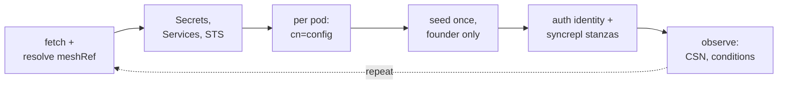

# slaptain

<div class="mt-6 text-xl text-gray-300">
  A Kubernetes operator for multi-site,<br>multi-master OpenLDAP
</div>

<div class="pt-10 text-gray-400">
  Dominik Epple · LDAPCon
</div>

<div class="pt-1 text-gray-500">
  dominik.epple@gmail.com
</div>

<div class="pt-2 text-sm text-gray-500">
  slaptain.chuck-chuck-chuck.net · Apache-2.0
</div>

---
layout: default
---

# For starters: One question

<div class="text-xl text-gray-300">
Hands up:
</div>

<div class="mt-6 p-5 bg-gray-800 rounded-lg">
  <div class="text-2xl">Who in this room has OpenLDAP on Kubernetes <b>on the table</b>?</div>
  <div class="mt-3 text-lg text-gray-400">
  You run it. You would like to run it. Or you suspect somebody will decide it for you.
  </div>
</div>

<div v-click class="mt-6 p-4 bg-gray-800 rounded-lg border-l-4 border-blue-400 text-xl text-blue-400">
<b>Hand up?</b> This talk is for you — I have something that might make it better.
</div>

<div v-click class="mt-3 p-4 bg-gray-800 rounded-lg border-l-4 border-blue-400 text-xl text-gray-300">
<b>Hand down?</b> This talk is for you too — don't tune out. The grass on the Kubernetes side might be surprisingly green.
</div>


---
layout: default
---

# Agenda

<div class="grid grid-cols-1 gap-2 mt-4">
  <div class="p-2.5 bg-gray-800 rounded-lg">
    <span class="text-blue-400 text-sm">1</span>
    <span class="text-base ml-2">Motivation: The case for Kubernetes</span>
  </div>
  <div class="p-2.5 bg-gray-800 rounded-lg">
    <span class="text-blue-400 text-sm">2</span>
    <span class="text-base ml-2">What slaptain wants to do (and already does)</span>
  </div>
  <div class="p-2.5 bg-gray-800 rounded-lg">
    <span class="text-blue-400 text-sm">3</span>
    <span class="text-base ml-2">The <code>slapd</code> image we ship</span>
  </div>
  <div class="p-2.5 bg-gray-800 rounded-lg">
    <span class="text-blue-400 text-sm">4</span>
    <span class="text-base ml-2">Single-site and multi-site architecture</span>
  </div>
  <div class="p-2.5 bg-gray-800 rounded-lg">
    <span class="text-blue-400 text-sm">5</span>
    <span class="text-base ml-2">Backup and restore</span>
  </div>
  <div class="p-2.5 bg-gray-800 rounded-lg">
    <span class="text-blue-400 text-sm">6</span>
    <span class="text-base ml-2">How this got written</span>
  </div>
</div>

---
layout: default
---

# About me

Dominik Epple

<div class="relative mt-4" style="height:140px">

  <div v-click.hide="1" class="absolute top-0 left-0 right-0 p-4 bg-gray-800 rounded-lg">
    <div class="text-sm text-gray-500 uppercase tracking-wide">Day job</div>
    <div class="mt-2 text-lg text-gray-300">
      Principal Architect at Open-Xchange
    </div>
    <div class="mt-2 text-lg text-gray-300">
      Email, Webmail, Groupware, as Software, and as Managed Service<sup class="text-blue-400">1</sup>
    </div>
    <div class="mt-2 text-lg text-gray-300">
      Kubernetes-first, all in:  our own
      components, and the entire stack
      <span class="text-blue-400">(yes, this includes OpenLDAP)</span>
    </div>
    <div class="mt-2 text-sm text-gray-500">
      dominik.epple@open-xchange.com
    </div>
  </div>

  <div v-click="1" class="absolute top-0 left-0 right-0 p-4 bg-gray-800 rounded-lg">
    <div class="text-sm text-gray-500 uppercase tracking-wide">Spare time</div>
    <div class="mt-2 text-lg text-gray-300">
      New hobby: Creating missing Kubernetes operators.
    </div>
    <div class="mt-2 text-lg text-gray-300">
      <span class="text-blue-400">slaptain</span> is one of them.<sup class="text-blue-400">1</sup>
    </div>
    <div class="mt-2 text-sm text-gray-500">
      dominik.epple@gmail.com
    </div>
  </div>

</div>

<div v-click="1" class="mt-6 text-lg text-amber-400">
Today I am here as this one.
</div>

<div class="abs-bl m-6 text-xs text-gray-500">
  <div class="relative" style="height:1.4em;width:64ch">
    <div v-click.hide="1" class="absolute inset-0 flex gap-1.5"><span style="flex:none">1 —</span><span>documentation.open-xchange.com/appsuite/operation-guides/</span></div>
    <div v-click="1" class="absolute inset-0 flex gap-1.5"><span style="flex:none">1 —</span><span>github.com/chuck-chuck-chuck-net/littlered for Redis is the other one</span></div>
  </div>
</div>

---
layout: default
---

# Behind the name

<div class="grid grid-cols-2 gap-8 mt-6">

<div class="p-5 bg-gray-800 rounded-lg">
  <div class="font-mono text-3xl text-blue-400">slapd</div>
  <div class="mt-1 text-gray-500"><em>n.</em> &nbsp;stand-alone LDAP daemon</div>
  <div class="mt-4 text-lg text-gray-300 leading-snug">
    “It listens for LDAP connections on any number of ports (default 389),
    responding to the LDAP operations it receives over these connections.”
  </div>
  <div class="mt-3 text-sm text-gray-500 text-right">— <span class="font-mono">slapd(8)</span></div>
</div>

<div class="p-5 text-lg text-gray-300 leading-relaxed">
  A Kubernetes operator's job is to steer, automate and manage the lifecycle of a
  workload.
  <div class="mt-4">
    Making it the <span class="text-blue-400">captain</span> of <code>slapd</code> is a
    perfect conceptual fit.
  </div>
</div>

</div>

<div v-click class="mt-10 flex items-baseline justify-center gap-5 text-5xl text-gray-300">
  <span class="font-mono text-blue-400">slaptain</span>
  <span class="text-gray-500">=</span>
  <span class="font-mono">slapd</span>
  <span class="text-gray-500">+</span>
  <span>captain</span>
</div>

<div class="abs-bl m-6 text-xs text-gray-600 leading-tight">
And <code>chuck-chuck-chuck.net</code>? That is the little red hen, who said it a lot —
github.com/chuck-chuck-chuck-net/littlered#behind-the-name
</div>


---
layout: section
---

# Motivation

<div class="text-gray-400 mt-4">It is worth seeing where this leads.</div>

---
layout: default
---

<div class="flex items-center gap-4 pb-4">
  <div class="text-sm text-gray-300 uppercase tracking-wide">Motivation — the case for Kubernetes</div>
  <div class="flex gap-1.5">
    <div class="w-10 h-1 rounded-full bg-blue-400"></div>
    <div class="w-10 h-1 rounded-full bg-gray-700"></div>
    <div class="w-10 h-1 rounded-full bg-gray-700"></div>
  </div>
</div>

# It works.

<div class="mt-8 space-y-3">
  <div class="px-5 py-4 bg-gray-800 rounded-lg text-2xl text-gray-300">
  A container is process isolation — same kernel, same syscalls
  </div>
  <div class="px-5 py-4 bg-gray-800 rounded-lg text-2xl text-gray-300">
  Persistence is the part Kubernetes already solved
  </div>
  <div class="px-5 py-4 bg-gray-800 rounded-lg text-2xl border-l-4 border-blue-400 text-blue-400">
  Postgres, Cassandra, Kafka run this way. This is not new ground.
  </div>
</div>

---
layout: default
---

<div class="flex items-center gap-4 pb-4">
  <div class="text-sm text-gray-300 uppercase tracking-wide">Motivation — the case for Kubernetes</div>
  <div class="flex gap-1.5">
    <div class="w-10 h-1 rounded-full bg-blue-400"></div>
    <div class="w-10 h-1 rounded-full bg-blue-400"></div>
    <div class="w-10 h-1 rounded-full bg-gray-700"></div>
  </div>
</div>

# It works <b>like a charm</b>.

<div class="mt-8 space-y-3">
  <div class="px-5 py-4 bg-gray-800 rounded-lg text-2xl text-gray-300">
  Compute, storage, network, secrets — declared, and kept that way
  </div>
  <div class="px-5 py-4 bg-gray-800 rounded-lg text-2xl text-gray-300">
  Upgrading is a new image tag. Rolling back is the old one.
  </div>
  <div class="px-5 py-4 bg-gray-800 rounded-lg text-2xl border-l-4 border-blue-400 text-blue-400">
  The same files run in a lab, in a cloud, or for one test run
  </div>
</div>


---
layout: default
---

<div class="flex items-center gap-4 pb-4">
  <div class="text-sm text-gray-300 uppercase tracking-wide">Motivation — the case for Kubernetes</div>
  <div class="flex gap-1.5">
    <div class="w-10 h-1 rounded-full bg-blue-400"></div>
    <div class="w-10 h-1 rounded-full bg-blue-400"></div>
    <div class="w-10 h-1 rounded-full bg-blue-400"></div>
  </div>
</div>

# <b>Profit!</b>

<div class="mt-8 space-y-3">
  <div class="px-5 py-4 bg-gray-800 rounded-lg text-2xl text-gray-300">
  “Do you run on Kubernetes?” is now a procurement question
  </div>
  <div class="px-5 py-4 bg-gray-800 rounded-lg text-2xl text-gray-300">
  The directory stops being the exception with its own tooling
  </div>
  <div class="px-5 py-4 bg-gray-800 rounded-lg text-2xl border-l-4 border-blue-400 text-blue-400">
  The last workload on VMs does not cost you a VM.<br>It costs you everything it takes to keep running VMs.
  </div>
</div>

---
layout: default
---

# And my personal motivation?

<div class="mt-8 space-y-4 text-xl text-gray-300">
  <div><span class="text-blue-400 font-bold">Learn agentic coding.</span> Agentic methods are disrupting software engineering.</div>
  <div><span class="text-blue-400 font-bold">On something real.</span> A gap that is blocking my day job.</div>
  <div><span class="text-blue-400 font-bold">In spare time.</span> Because it is not part of that job.</div>
  <div><span class="text-blue-400 font-bold">As open source.</span> To give back, and to benefit as well.</div>
</div>

<div class="mt-8 px-5 py-4 bg-gray-800 rounded-lg border-l-4 border-blue-400 text-xl text-blue-400">
Which is why replication, migration and multi-site were in scope from day one.<br>
The success criterion was never a nice demo. It was my reality at work.
</div>

---
layout: default
---

# And what I want this talk to do

<div class="mt-8 space-y-4 text-xl text-gray-300">
  <div><span class="text-blue-400 font-bold">Know that slaptain exists.</span> That is most of it already.</div>
  <div><span class="text-blue-400 font-bold">About to write your own Helm chart?</span> Try slaptain first.</div>
  <div><span class="text-blue-400 font-bold">Need an LDAP lab?</span> A namespace each, a hundred of them, in seconds.</div>
  <div><span class="text-blue-400 font-bold">Multi-site, multi-cluster?</span> You need slaptain. Or find something like it — I did not.</div>
  <div><span class="text-blue-400 font-bold">Then tell me.</span> Bugs, missing features, bad defaults, bad replication design.</div>
</div>

<div class="mt-8 px-5 py-4 bg-gray-800 rounded-lg border-l-4 border-blue-400 text-xl text-blue-400">
Use it. Clone it. Fork it. Star it. Break it — and tell me how.<br>
Everything you report is something I can fix (maybe).
</div>

---
layout: section
---

# Requirements

<div class="text-gray-400 mt-4">Goals. What we set out to achieve.</div>

---
layout: default
clicks: 1
---

# `slaptain` requirements

<div class="grid grid-cols-2 gap-3 mt-4 text-lg">

<div class="p-3 bg-gray-800 rounded-lg">
<div class="text-blue-400 text-sm mb-2">THE PLATFORM</div>

Make OpenLDAP meet the expectations people have of a
<span class="transition-colors duration-300" :class="$clicks >= 1 ? 'text-blue-400' : ''">cloud-native, Kubernetes-first</span> application — which, by itself,
it does not.

Declarative end to end. Fully gitops-able.
</div>

<div class="p-3 bg-gray-800 rounded-lg">
<div class="text-blue-400 text-sm mb-2">THE DIRECTORY</div>

Production-grade OpenLDAP out of the box.

<span class="transition-colors duration-300" :class="$clicks >= 1 ? 'text-blue-400' : ''">N-way multi-master delta-syncrepl</span>, plus read-only consumers.

<span class="transition-colors duration-300" :class="$clicks >= 1 ? 'text-blue-400' : ''">Multi-site and multi-cluster</span>, with whichever cross-site transport that needs.
</div>

<div class="p-3 bg-gray-800 rounded-lg">
<div class="text-blue-400 text-sm mb-2">THE LIFECYCLE</div>

<span class="transition-colors duration-300" :class="$clicks >= 1 ? 'text-blue-400' : ''">Migration</span> of existing deployments — syncrepl, delta-syncrepl, hot and cold.

<span class="transition-colors duration-300" :class="$clicks >= 1 ? 'text-blue-400' : ''">Backup, restore</span>, disaster recovery.
</div>

<div class="p-3 bg-gray-800 rounded-lg">
<div class="text-blue-400 text-sm mb-2">THE QUALITY BAR</div>

First-class security by default — where it does not cost functionality.

Tooling worth having: deployment, observability, <span class="transition-colors duration-300" :class="$clicks >= 1 ? 'text-blue-400' : ''">debugging</span>, bug reports.
</div>

</div>

---
layout: default
---

# Requirements, and where we stand

<div class="grid grid-cols-2 gap-x-6 gap-y-2 mt-6 text-lg">

  <div class="flex gap-2 items-baseline text-gray-300"><span class="text-blue-400" style="display:inline-flex;align-items:center;justify-content:center;width:1.05em;height:1.05em;flex:none;border:2px solid currentColor;border-radius:3px;font-size:0.82em;line-height:1">✓</span><span>Declarative end-to-end, gitops all the way</span></div>
  <div class="flex gap-2 items-baseline text-gray-300"><span class="text-blue-400" style="display:inline-flex;align-items:center;justify-content:center;width:1.05em;height:1.05em;flex:none;border:2px solid currentColor;border-radius:3px;font-size:0.82em;line-height:1">✓</span><span>Backup, restore, disaster recovery — to S3</span></div>

  <div class="flex gap-2 items-baseline text-gray-300"><span class="text-blue-400" style="display:inline-flex;align-items:center;justify-content:center;width:1.05em;height:1.05em;flex:none;border:2px solid currentColor;border-radius:3px;font-size:0.82em;line-height:1">✓</span><span>N-way multi-master delta-syncrepl, plus consumers</span></div>
  <div class="flex gap-2 items-baseline text-gray-300"><span class="text-blue-400" style="display:inline-flex;align-items:center;justify-content:center;width:1.05em;height:1.05em;flex:none;border:2px solid currentColor;border-radius:3px;font-size:0.82em;line-height:1">✓</span><span>Databases, schemas, ACLs as custom resources</span></div>

  <div class="flex gap-2 items-baseline text-gray-300"><span class="text-blue-400" style="display:inline-flex;align-items:center;justify-content:center;width:1.05em;height:1.05em;flex:none;border:2px solid currentColor;border-radius:3px;font-size:0.82em;line-height:1">✓</span><span>Multi-site, cluster per site, cross-site transports</span></div>
  <div class="flex gap-2 items-baseline text-gray-300"><span class="text-blue-400" style="display:inline-flex;align-items:center;justify-content:center;width:1.05em;height:1.05em;flex:none;border:2px solid currentColor;border-radius:3px;font-size:0.82em;line-height:1">✓</span><span>Security defaults that do not cost functionality</span></div>

  <div class="flex gap-2 items-baseline text-gray-300"><span class="text-blue-400" style="display:inline-flex;align-items:center;justify-content:center;width:1.05em;height:1.05em;flex:none;border:2px solid currentColor;border-radius:3px;font-size:0.82em;line-height:1">✓</span><span>Migration of existing deployments, hot and cold</span></div>
  <div class="flex gap-2 items-baseline text-gray-300"><span class="text-blue-400" style="display:inline-flex;align-items:center;justify-content:center;width:1.05em;height:1.05em;flex:none;border:2px solid currentColor;border-radius:3px;font-size:0.82em;line-height:1">✓</span><span>Tooling: <code>slctl</code>, conditions, e2e across three sites</span></div>


</div>

<div class="mt-4 flex gap-2 items-baseline text-lg text-gray-400">
  <span class="text-amber-400" style="display:inline-flex;align-items:center;justify-content:center;width:1.05em;height:1.05em;flex:none;border:2px solid currentColor;border-radius:3px;font-size:0.82em;line-height:1">&nbsp;</span><span>Production-grade OpenLDAP out of the box</span>
</div>

<div class="mt-10 text-2xl text-amber-400">
That last one is not mine to tick.
</div>


---
layout: section
---

# Our purpose-built image

<div class="text-gray-400 mt-4">What runs in the pod, before anything orchestrates it.</div>

---
layout: default
---

# The `slapd` container image

<div class="text-xl text-gray-300">
Purpose-built container image: Control and trust; requirements and best practices.
</div>

<div class="mt-8 grid grid-cols-5 gap-x-6 gap-y-4 text-xl items-baseline">

  <div class="col-span-1 text-right text-gray-500">base</div>
  <div class="col-span-4 text-gray-200"><code>gcr.io/distroless/base-debian13</code></div>

  <div class="col-span-1 text-right text-gray-500">built from</div>
  <div class="col-span-4 text-gray-200"><code>debian:trixie-slim</code> builder — Debian's own OpenLDAP packaging<sup>1</sup></div>

  <div class="col-span-1 text-right text-gray-500">runs as</div>
  <div class="col-span-4 text-gray-200">uid/gid 1024 · ports 1024 / 1025 · no capabilities</div>

  <div class="col-span-1 text-right text-gray-500">root fs</div>
  <div class="col-span-4 text-gray-200">read-only</div>

  <div class="col-span-1 text-right text-gray-500">config</div>
  <div class="col-span-4 text-gray-200"><code>cn=config</code>, live-writable — no <code>slapd.conf</code> at runtime</div>

  <div class="col-span-1 text-right text-gray-500">volumes</div>
  <div class="col-span-4 text-gray-200"><code>config</code> · <code>data</code> · <code>accesslog</code></div>

  <div class="col-span-1 text-right text-gray-500">bootstrap</div>
  <div class="col-span-4 text-gray-200">init container, same package set — no entrypoint script</div>

</div>

<div class="abs-bl m-6 text-sm text-gray-300 space-y-0.5">
  <div class="flex gap-1.5"><span style="flex:none">1 —</span><span>Currently: 2.7.1 built by us with Debian's own packaging scripts. Revert to Debian upstream once it ships 2.7.</span></div>
</div>

---
layout: section
---

# First, one site

<div class="text-gray-400 mt-4">
What it is, what you write, and how you check it worked.
</div>

---
layout: default
---

# One site

<div class="text-sm text-gray-400">
Three slapd pods, all read-write, all equal. One operator, and nothing else in the picture.
</div>

<svg viewBox="0 0 700 328" style="display:block;width:100%;height:309px;margin:0 auto" xmlns="http://www.w3.org/2000/svg">
<defs>
<marker id="s1" viewBox="0 0 10 10" refX="9" refY="5" markerWidth="6" markerHeight="6" orient="auto-start-reverse">
 <path d="M0,0 L10,5 L0,10 z" fill="#60a5fa"/></marker>
<marker id="s2" viewBox="0 0 10 10" refX="9" refY="5" markerWidth="5" markerHeight="5" orient="auto-start-reverse">
 <path d="M0,0 L10,5 L0,10 z" fill="#6b7280"/></marker></defs>
<rect x="60" y="16" width="600" height="296" rx="14" fill="#111827" stroke="#6b7280" stroke-width="1.5"/>
<text x="88" y="76" style="font-family:'Fira Code',monospace;font-size:20px" fill="#d1d5db">site-1</text>
<text x="88" y="100" style="font-family:Inter,sans-serif;font-size:13px" fill="#6b7280">one Kubernetes cluster</text>
<rect x="88" y="181" width="150" height="48" rx="8" fill="#1f2937" stroke="#6b7280" stroke-width="1.5"/>
<text x="163" y="211" text-anchor="middle" style="font-family:Inter,sans-serif;font-size:16px" fill="#9ca3af">operator</text>
<text x="163" y="253" text-anchor="middle" style="font-family:'Fira Code',monospace;font-size:12px" fill="#6b7280">siteName=site-1</text>
<line x1="240" y1="205" x2="300" y2="205" stroke="#6b7280" stroke-width="1.5" stroke-dasharray="5 4" marker-end="url(#s2)"/>
<line x1="437" y1="149" x2="491" y2="85" stroke="#60a5fa" stroke-width="2" stroke-dasharray="5 4" marker-end="url(#s1)"/>
<line x1="454" y1="175" x2="532" y2="139" stroke="#60a5fa" stroke-width="2" stroke-dasharray="5 4" marker-end="url(#s1)"/>
<line x1="467" y1="205" x2="547" y2="205" stroke="#60a5fa" stroke-width="2" stroke-dasharray="5 4" marker-end="url(#s1)"/>
<circle cx="509" cy="63" r="23" fill="#1f2937" stroke="#60a5fa" stroke-width="2" stroke-dasharray="4 3"/>
<circle cx="558" cy="127" r="23" fill="#1f2937" stroke="#60a5fa" stroke-width="2" stroke-dasharray="4 3"/>
<circle cx="575" cy="205" r="23" fill="#1f2937" stroke="#60a5fa" stroke-width="2" stroke-dasharray="4 3"/>
<line x1="373" y1="149" x2="333" y2="218" stroke="#60a5fa" stroke-width="2.5" marker-start="url(#s1)" marker-end="url(#s1)"/>
<line x1="407" y1="149" x2="447" y2="218" stroke="#60a5fa" stroke-width="2.5" marker-start="url(#s1)" marker-end="url(#s1)"/>
<line x1="350" y1="247" x2="430" y2="247" stroke="#60a5fa" stroke-width="2.5" marker-start="url(#s1)" marker-end="url(#s1)"/>
<circle cx="390" cy="120" r="32" fill="#1f2937" stroke="#60a5fa" stroke-width="2.5"/>
<text x="390" y="126" text-anchor="middle" style="font-family:'Fira Code',monospace;font-size:16px" fill="#d1d5db">1</text>
<circle cx="316" cy="247" r="32" fill="#1f2937" stroke="#60a5fa" stroke-width="2.5"/>
<text x="316" y="253" text-anchor="middle" style="font-family:'Fira Code',monospace;font-size:16px" fill="#d1d5db">2</text>
<circle cx="464" cy="247" r="32" fill="#1f2937" stroke="#60a5fa" stroke-width="2.5"/>
<text x="464" y="253" text-anchor="middle" style="font-family:'Fira Code',monospace;font-size:16px" fill="#d1d5db">3</text>
<text x="575" y="260" text-anchor="middle" style="font-family:Inter,sans-serif;font-size:13px" fill="#6b7280">read-only</text>
<text x="575" y="277" text-anchor="middle" style="font-family:Inter,sans-serif;font-size:13px" fill="#6b7280">consumers</text>
</svg>

<div class="mt-2 grid grid-cols-2 gap-4 text-sm">
  <div class="p-4 bg-gray-800 rounded-lg text-gray-300">
    Every pod replicates from every other — N-way multi-master, no primary. Their
    <code>olcServerID</code>s are <strong>1, 2, 3</strong>: derived from the pod's ordinal,
    never configured by hand.
  </div>
  <div class="p-4 bg-gray-800 rounded-lg text-gray-300">
    The dashed ones are <strong>consumers</strong>: they pull from the mesh and take reads.
    Nothing replicates from them, and they have no <code>olcServerID</code> at all.
  </div>
</div>


---
layout: default
---

# Installing the operator

<div class="mt-2 px-5 py-3 bg-gray-800 rounded-lg border-l-4 border-blue-400">
  <span class="font-mono text-blue-400" style="font-size:1.05rem">% helm install -n slaptain-system slaptain \<br>
  > oci://ghcr.io/chuck-chuck-chuck-net/charts/slaptain</span>
</div>

<div class="grid grid-cols-2 gap-3 mt-3 text-sm">

<div class="p-3 bg-gray-800 rounded-lg">
<div class="text-blue-400 mb-1">Seven new kinds</div>

The API server can now store, validate and serve <code>SlapdMesh</code>,
<code>SlapdCluster</code>, <code>SlapdDatabase</code> and <code>SlapdSchema</code> — plus
three more for backup and restore.

<div class="mt-2 text-gray-400">
Until now it knew generic terms for compute, storage, network. Now it has words for a
<em>directory</em> too.
</div>
</div>

<div class="p-3 bg-gray-800 rounded-lg">
<div class="text-blue-400 mb-1">One pod</div>

The controller. It watches those kinds and does nothing whatsoever until one of them
appears.

<div class="mt-2 text-gray-400">
Everything for the rest of this talk is its reaction to an object somebody applied.
</div>
</div>

</div>

<div class="mt-4 text-lg text-blue-400">
<code>kubectl apply</code> gives you a noun and a verb. Everything between that and a
running, correctly configured, replicating directory is knowledge — and it lives in that pod.
</div>

---
layout: default
clicks: 2
---

# <code>slaptain</code> Custom Resources

<svg viewBox="0 0 720 297" style="display:block;width:100%;height:272px;margin:0 auto" xmlns="http://www.w3.org/2000/svg">
<defs><marker id="k1" viewBox="0 0 10 10" refX="9" refY="5" markerWidth="6" markerHeight="6" orient="auto">
 <path d="M0,0 L10,5 L0,10 z" fill="#60a5fa"/></marker></defs>
<g v-click="1">
<rect x="390" y="10" width="300" height="121" rx="10" fill="#1f2937" stroke="#6b7280" stroke-width="1.5"/>
<text x="404" y="34" style="font-family:'Fira Code',monospace;font-size:12px"><tspan fill="#9ca3af">kind: </tspan><tspan fill="#e5e7eb">SlapdSchema</tspan></text>
<text x="404" y="51" style="font-family:'Fira Code',monospace;font-size:12px"><tspan fill="#9ca3af">metadata:</tspan></text>
<text x="404" y="68" style="font-family:'Fira Code',monospace;font-size:12px"><tspan fill="#9ca3af">  name: </tspan><tspan fill="#d1d5db">demo-schema</tspan></text>
<text x="404" y="85" style="font-family:'Fira Code',monospace;font-size:12px"><tspan fill="#9ca3af">spec:</tspan></text>
<text x="404" y="102" style="font-family:'Fira Code',monospace;font-size:12px"><tspan fill="#9ca3af">  clusterRef: </tspan><tspan fill="#60a5fa">slapd</tspan></text>
<text x="404" y="119" style="font-family:'Fira Code',monospace;font-size:12px"><tspan fill="#6b7280">  # attributeTypes, objectClasses</tspan></text>
<path d="M384,97 C320,97 290,149 226,149" fill="none" stroke="#60a5fa" stroke-width="2" marker-end="url(#k1)"/>
</g>
<g v-click="2">
<rect x="390" y="149" width="300" height="138" rx="10" fill="#1f2937" stroke="#6b7280" stroke-width="1.5"/>
<text x="404" y="173" style="font-family:'Fira Code',monospace;font-size:12px"><tspan fill="#9ca3af">kind: </tspan><tspan fill="#e5e7eb">SlapdDatabase</tspan></text>
<text x="404" y="190" style="font-family:'Fira Code',monospace;font-size:12px"><tspan fill="#9ca3af">metadata:</tspan></text>
<text x="404" y="207" style="font-family:'Fira Code',monospace;font-size:12px"><tspan fill="#9ca3af">  name: </tspan><tspan fill="#d1d5db">demo-db</tspan></text>
<text x="404" y="224" style="font-family:'Fira Code',monospace;font-size:12px"><tspan fill="#9ca3af">spec:</tspan></text>
<text x="404" y="241" style="font-family:'Fira Code',monospace;font-size:12px"><tspan fill="#9ca3af">  clusterRef: </tspan><tspan fill="#60a5fa">slapd</tspan></text>
<text x="404" y="258" style="font-family:'Fira Code',monospace;font-size:12px"><tspan fill="#9ca3af">  suffix: </tspan><tspan fill="#d1d5db">&quot;dc=demo,dc=example&quot;</tspan></text>
<text x="404" y="275" style="font-family:'Fira Code',monospace;font-size:12px"><tspan fill="#6b7280">  # replication, acls, indices, seed</tspan></text>
<path d="M384,236 C320,236 290,149 226,149" fill="none" stroke="#60a5fa" stroke-width="2" marker-end="url(#k1)"/>
</g>
<rect x="30" y="96" width="190" height="104" rx="10" fill="#1f2937" stroke="#6b7280" stroke-width="1.5"/>
<text x="44" y="120" style="font-family:'Fira Code',monospace;font-size:12px"><tspan fill="#9ca3af">kind: </tspan><tspan fill="#e5e7eb">SlapdCluster</tspan></text>
<text x="44" y="137" style="font-family:'Fira Code',monospace;font-size:12px"><tspan fill="#9ca3af">metadata:</tspan></text>
<text x="44" y="154" style="font-family:'Fira Code',monospace;font-size:12px"><tspan fill="#9ca3af">  name: </tspan><tspan fill="#60a5fa">slapd</tspan></text>
<text x="44" y="171" style="font-family:'Fira Code',monospace;font-size:12px"><tspan fill="#9ca3af">spec:</tspan></text>
<text x="44" y="188" style="font-family:'Fira Code',monospace;font-size:12px"><tspan fill="#9ca3af">  replicas: </tspan><tspan fill="#d1d5db">3</tspan></text>
</svg>

<div class="grid grid-cols-2 gap-4 mt-3 text-sm">
  <div class="px-3 py-2 bg-gray-800 rounded-lg leading-snug">
    <div class="text-blue-400 mb-1">The cluster carries the running things</div>
    <div class="text-gray-300">pods, volumes, services, TLS, how many replicas and how many consumers. Nothing about what is <em>in</em> the directory.</div>
  </div>
  <div v-click="2" class="px-3 py-2 bg-gray-800 rounded-lg leading-snug">
    <div class="text-blue-400 mb-1">The database and the schema carry the directory</div>
    <div class="text-gray-300">a suffix, its ACLs, its indices, its replication — and schema separately, because schema outlives any one database.</div>
  </div>
</div>

<div v-click="2" class="mt-3 text-sm text-gray-300">
One cluster can hold several databases. That is why they are separate objects and not
fields on one.
</div>
---
layout: default
---

# How boring can a cluster be?

<div class="text-sm text-gray-400">
Replicas, TLS, replication on — and defaults for the rest. Nothing here carries meaning:
the suffix, the ACLs, the indices, the schema all live in the other objects.
</div>

<div class="grid grid-cols-2 gap-6 mt-3">

<div>

```yaml
# slapdcluster.yaml
apiVersion: ldap.chuck-chuck-chuck.net/v1alpha1
kind: SlapdCluster
metadata:
  name: slapd
  namespace: slaptain
spec:
  ldap:
    tls:
      enabled: true
      secretName: slapd-tls
  replicas: 3
  readReplicas: 1
  replication:
    enabled: true
```

<div class="mt-4">

```bash
% kubectl apply -f slapdcluster.yaml
```

</div>

</div>

<div>

<div class="p-4 bg-gray-800 rounded-lg text-sm leading-relaxed">
<div class="text-blue-400 mb-2">What that produces</div>

Two StatefulSets — <code>slapd</code> 3/3 and <code>slapd-readonly</code> 1/1.

<div class="mt-3">
Volumes per pod — read-write: <code>config</code>, <code>data</code>,
<code>accesslog</code>. Read-only: <code>config</code>, <code>data</code>.
</div>

<div class="mt-3">
Four Services — <code>slapd</code> and <code>slapd-readonly</code> for clients,
a headless pair for the pods themselves.
</div>
</div>

<div v-click class="mt-3 p-4 bg-gray-800 rounded-lg text-sm leading-relaxed">
The Services answer on <code>389</code> and <code>636</code>. The pods listen
unprivileged on <code>1024</code> and <code>1025</code>
<span class="text-blue-400">— clients never find out</span>.
</div>

</div>

</div>
---
layout: default
---

# And now the considerably less boring part

<div class="grid grid-cols-2 gap-4 mt-3">

<div>

```yaml
# kubectl apply -f slapdschema.yaml
kind: SlapdSchema
metadata:
  name: demo-schema
spec:
  clusterRef: slapd
  priority: 100
  attributeTypes:
    - >-
      ( 1.3.6.1.4.1.99999.1.1.3
        NAME 'demoQuota'
        EQUALITY integerMatch
        SYNTAX 1.3.6.1.4.1.1466.115.121.1.27
        SINGLE-VALUE )
  objectClasses:
    - >-
      ( 1.3.6.1.4.1.99999.1.2.1
        NAME 'demoUser'
        SUP inetOrgPerson STRUCTURAL
        MAY ( demoContextId $ demoQuota ) )
```

</div>

<div>

```yaml
# kubectl apply -f slapddatabase.yaml
kind: SlapdDatabase
metadata:
  name: demo-db
spec:
  clusterRef: slapd
  suffix: "dc=demo,dc=example"
  acls:
    - >-
      to attrs=userPassword
      by self write
      by anonymous auth
      by * none                 # …and two more
  indices:
    - "objectClass eq"          # …and four more
  replication:
    ridSegment: 0
    deltaSync: true
  seed:
    entries:                    # …and four more
      - |
        dn: dc=demo,dc=example
        objectClass: organization
  cleanupPolicy: Retain
```

</div>

</div>

<style>
pre.slidev-code { font-size: 0.67rem !important; line-height: 1.35 !important; }
</style>
---
layout: default
---

# What differs between the pods

<div class="text-sm text-gray-400">
<code>slctl ldapsearch --as config --pod slapd-N -- -b cn=config '(|(olcServerID=*)(olcSyncrepl=*))'</code>
</div>

<div class="grid grid-cols-3 gap-3 mt-3 text-xs">

<div class="p-3 bg-gray-800 rounded-lg">
<div class="text-blue-400 text-sm mb-2">slapd-0</div>

```
dn: cn=config
olcServerID: 1

dn: olcDatabase={2}mdb,cn=config
olcSyncrepl: {0}rid=002
  provider=ldaps://slapd-1…
olcSyncrepl: {1}rid=003
  provider=ldaps://slapd-2…
```
</div>

<div class="p-3 bg-gray-800 rounded-lg">
<div class="text-blue-400 text-sm mb-2">slapd-1</div>

```
dn: cn=config
olcServerID: 2

dn: olcDatabase={2}mdb,cn=config
olcSyncrepl: {0}rid=001
  provider=ldaps://slapd-0…
olcSyncrepl: {1}rid=003
  provider=ldaps://slapd-2…
```
</div>

<div class="p-3 bg-gray-800 rounded-lg">
<div class="text-blue-400 text-sm mb-2">slapd-2</div>

```
dn: cn=config
olcServerID: 3

dn: olcDatabase={2}mdb,cn=config
olcSyncrepl: {0}rid=001
  provider=ldaps://slapd-0…
olcSyncrepl: {1}rid=002
  provider=ldaps://slapd-1…
```
</div>

</div>

<div class="mt-5 text-xl text-blue-400">
Same image, same chart, same CRs.<br>Two facts differ per pod — and the operator derived both.
</div>

<div class="mt-2 text-sm text-gray-500">
Everything else in every stanza is identical: <code>searchbase</code>,
<code>syncdata=accesslog</code>, <code>logbase</code>, <code>logfilter</code>, TLS,
<code>retry</code>. The <code>rid</code> is the database's segment plus the provider's pod
ordinal — this database sits in segment 0, which starts at 1 — so a stanza names the peer
it points at, and no pod carries one for itself.
</div>

---
layout: default
---

# Is it actually replicating?

<div class="text-sm text-gray-400">
<code>ldapsearch -b dc=demo,dc=example -s base contextCSN</code> — anonymous, on every pod.
</div>

<div class="grid grid-cols-2 gap-4 mt-3">

<div class="p-3 bg-gray-800 rounded-lg">
<div class="text-blue-400 text-sm mb-2">Before — all four pods</div>

```
contextCSN: 2026…173503.489521Z#000000#001#000000
```
</div>

<div class="p-3 bg-gray-800 rounded-lg">
<div class="text-blue-400 text-sm mb-2">After — all four pods</div>

```
contextCSN: 2026…173503.489521Z#000000#001#000000
contextCSN: 2026…180925.496164Z#000000#003#000000
```
</div>

</div>

<div class="mt-3 px-4 py-2 bg-gray-800 rounded-lg text-sm">
In between, one write — <code>uid=alice,ou=People,dc=demo,dc=example</code>, added on
<em>one</em> pod and read back from another.
</div>

<div class="mt-4 text-xl text-blue-400">
<code>contextCSN</code> is a vector: one value per server that has ever written.
</div>

<div class="mt-2 text-sm text-gray-500">
<code>#001#</code> is the founder's seed. <code>#003#</code> is slapd-2 taking Alice —
the same <code>sid</code> as its <code>olcServerID</code>. Four pods, one vector, including
the read-only replica.
</div>

---
layout: default
---

<div class="flex items-center gap-3 pb-2">
  <div class="text-sm text-amber-400 uppercase tracking-wide">Live</div>
  <div class="text-sm text-gray-500">run from <code>../slaptain-demo/</code></div>
</div>

# Operator installation

```bash
helm upgrade --install slaptain \
  oci://ghcr.io/chuck-chuck-chuck-net/charts/slaptain \
  -n slaptain-system --create-namespace
```

<div class="mt-4 text-sm text-gray-400 uppercase tracking-wide">Result</div>

```bash
kubectl -n slaptain-system get deploy,pod -l control-plane=controller-manager
```

```bash
kubectl api-resources --api-group=ldap.chuck-chuck-chuck.net
```

---
layout: default
---

<div class="flex items-center gap-3 pb-2">
  <div class="text-sm text-amber-400 uppercase tracking-wide">Live</div>
  <div class="text-sm text-gray-500">run from <code>../slaptain-demo/</code></div>
</div>

# One cluster

<div class="grid grid-cols-2 gap-5 mt-2">

<div>

```bash
kubectl create namespace slaptain-demo
```

```bash
../slaptain/tests/gencert.sh -n slaptain-demo \
  -s slapd -H slapd-headless slapd-tls
```

```bash
kubectl apply -f manifests/01-cluster.yaml
```

</div>

<div>

<div class="text-sm text-gray-400 uppercase tracking-wide mb-1">manifests/01-cluster.yaml</div>

```yaml
apiVersion: ldap.chuck-chuck-chuck.net/v1alpha1
kind: SlapdCluster
metadata:
  name: slapd
  namespace: slaptain-demo
spec:
  ldap:
    tls:
      enabled: true
      secretName: slapd-tls
  logLevel: 16640
  service:
    type: LoadBalancer
```

</div>

</div>

---
layout: default
---

<div class="flex items-center gap-3 pb-2">
  <div class="text-sm text-amber-400 uppercase tracking-wide">Live</div>
  <div class="text-sm text-gray-500">run from <code>../slaptain-demo/</code></div>
</div>

# What the operator made

<div class="text-sm text-gray-400">Thirteen lines of CR, and everything Kubernetes was told to create</div>

```bash
kubectl -n slaptain-demo get slapdcluster,statefulset,svc,secret,pvc
```

<div class="mt-2 text-sm text-gray-400">What the operator believes about it — status and conditions</div>

```bash
kubectl -n slaptain-demo get slapdcluster slapd
```

<div class="mt-2 text-sm text-gray-400">And the configuration itself, answering an LDAP query</div>

```bash
slctl ldapsearch -n slaptain-demo --as config --pod 0 \
  -b 'cn=config' -s base '(objectClass=*)'
```

<div class="mt-2 text-sm text-gray-400">Every database in the server, read out of the server</div>

```bash
slctl ldapsearch -n slaptain-demo --as config --pod 0 \
  -b cn=config -s sub '(objectClass=olcDatabaseConfig)' olcSuffix olcDbDirectory
```

---
layout: default
---

<div class="flex items-center gap-3 pb-2">
  <div class="text-sm text-amber-400 uppercase tracking-wide">Live</div>
  <div class="text-sm text-gray-500">run from <code>../slaptain-demo/</code></div>
</div>

# A schema

<div class="grid grid-cols-2 gap-5 mt-1">

<div>

<div class="text-sm text-gray-400">Attribute types and object classes, into a running server</div>

```bash
kubectl apply -f manifests/02-schema.yaml
```

</div>

<div class="yaml-mini">

<div class="text-sm text-gray-400 uppercase tracking-wide mb-1">manifests/02-schema.yaml</div>

```yaml
kind: SlapdSchema
spec:
  clusterRef: slapd
  priority: 100
  attributeTypes:
    - >-
      ( 1.3.6.1.4.1.99999.1.1.1 NAME 'demoContextId'
        EQUALITY integerMatch SINGLE-VALUE
        SYNTAX 1.3.6.1.4.1.1466.115.121.1.27 )
    - >-
      ( 1.3.6.1.4.1.99999.1.1.3 NAME 'demoQuota'
        EQUALITY integerMatch SINGLE-VALUE
        SYNTAX 1.3.6.1.4.1.1466.115.121.1.27 )
  objectClasses:
    - >-
      ( 1.3.6.1.4.1.99999.1.2.1 NAME 'demoUser'
        SUP inetOrgPerson STRUCTURAL
        MAY ( demoContextId $ demoQuota ) )
```

</div>

</div>

<style>
.yaml-mini .slidev-code {
  font-size: 0.8rem;
  line-height: 1.4;
}
</style>

---
layout: default
---

<div class="flex items-center gap-3 pb-2">
  <div class="text-sm text-amber-400 uppercase tracking-wide">Live</div>
  <div class="text-sm text-gray-500">run from <code>../slaptain-demo/</code></div>
</div>

# A database

<div class="grid grid-cols-2 gap-5 mt-1">

<div>

<div class="text-sm text-gray-400">A suffix, its ACLs, its indices, its replication settings — and seed entries</div>

```bash
kubectl apply -f manifests/03-database.yaml
```

<div class="mt-2 text-sm text-gray-400">What came of it</div>

```bash
kubectl -n slaptain-demo get slapddatabase demo-db
```

</div>

<div class="yaml-mini">

<div class="text-sm text-gray-400 uppercase tracking-wide mb-1">manifests/03-database.yaml</div>

```yaml
kind: SlapdDatabase
spec:
  clusterRef: slapd
  suffix: "dc=demo,dc=example"
  acls:
    - >-
      to attrs=userPassword
      by self write
      by anonymous auth
      by * none
    - >-
      to * by * read
  replication:
    ridBase: 100
    deltaSync: true
  indices:
    - "uid eq,sub"
    - "entryCSN eq"
  seed:
    entries:   # dc=demo, ou=People, ou=Groups, ...
```

</div>

</div>

<style>
.yaml-mini .slidev-code {
  font-size: 0.8rem;
  line-height: 1.4;
}
</style>

---
layout: default
---

<div class="flex items-center gap-3 pb-2">
  <div class="text-sm text-amber-400 uppercase tracking-wide">Live</div>
  <div class="text-sm text-gray-500">run from <code>../slaptain-demo/</code></div>
</div>

# Did it land?

<div class="text-sm text-gray-400">The schema entries, now in <code>cn=schema,cn=config</code></div>

```bash
slctl ldapsearch -n slaptain-demo --as config --pod 0 \
  -b cn=schema,cn=config -s one dn
```

<div class="mt-2 text-sm text-gray-400">The subschema, as any client sees it — ours among the standard ones</div>

```bash
slctl ldapsearch -n slaptain-demo --anonymous -o ldif-wrap=no \
  -b cn=subschema -s base objectClasses attributeTypes | grep -i demo
```

<div class="mt-2 text-sm text-gray-400">And the database the CR produced, as <code>slapd</code> has it</div>

```bash
slctl ldapsearch -n slaptain-demo --as config --pod 0 -o ldif-wrap=no \
  -b cn=config '(olcSuffix=dc=demo,dc=example)'
```

---
layout: default
---

<div class="flex items-center gap-3 pb-2">
  <div class="text-sm text-amber-400 uppercase tracking-wide">Live</div>
  <div class="text-sm text-gray-500">run from <code>../slaptain-demo/</code></div>
</div>

# Alice

<div class="text-sm text-gray-400">An entry that could not exist if the schema had not landed</div>

```bash
slctl ldapadd -n slaptain-demo <<'LDIF'
dn: uid=alice,ou=People,dc=demo,dc=example
objectClass: demoUser
cn: Alice Example
sn: Example
uid: alice
mail: alice@demo.example
userPassword: alicePassw0rd
demoContextId: 42
demoQuota: 1048576
LDIF
```

<div class="mt-2 text-sm text-gray-400">Read back, custom attributes and all</div>

```bash
slctl ldapsearch -n slaptain-demo -b "uid=alice,ou=People,dc=demo,dc=example" \
  cn mail demoContextId demoQuota
```

---
layout: default
---

<div class="flex items-center gap-3 pb-2">
  <div class="text-sm text-amber-400 uppercase tracking-wide">Live</div>
  <div class="text-sm text-gray-500">run from <code>../slaptain-demo/</code></div>
</div>

# Three masters, and a replica

<div class="grid grid-cols-2 gap-5 mt-1">

<div>

<div class="text-sm text-gray-400">What actually differs between the two files</div>

```bash
diff -u manifests/01-cluster.yaml \
  manifests/04-cluster-ha.yaml
```

<div class="mt-2 text-sm text-gray-400">Apply it and watch it converge — one paste, so the
watch is running before the pods are</div>

```bash
kubectl apply -f manifests/04-cluster-ha.yaml
kubectl get slapdcluster -n slaptain-demo slapd -w
```

<div class="mt-2 font-mono text-xs bg-gray-800 rounded-lg p-3 text-gray-300">
<div class="text-gray-500">NAME&nbsp;&nbsp;&nbsp;&nbsp;PHASE&nbsp;&nbsp;&nbsp;&nbsp;&nbsp;&nbsp;READY&nbsp;&nbsp;&nbsp;REPLICAS&nbsp;&nbsp;&nbsp;AGE</div>
<div>slapd&nbsp;&nbsp;&nbsp;<span class="text-amber-400">Degraded</span>&nbsp;&nbsp;&nbsp;1&nbsp;&nbsp;&nbsp;&nbsp;&nbsp;&nbsp;&nbsp;2&nbsp;&nbsp;&nbsp;&nbsp;&nbsp;&nbsp;&nbsp;&nbsp;&nbsp;&nbsp;20m</div>
<div>slapd&nbsp;&nbsp;&nbsp;<span class="text-amber-400">Degraded</span>&nbsp;&nbsp;&nbsp;2&nbsp;&nbsp;&nbsp;&nbsp;&nbsp;&nbsp;&nbsp;3&nbsp;&nbsp;&nbsp;&nbsp;&nbsp;&nbsp;&nbsp;&nbsp;&nbsp;&nbsp;20m</div>
<div>slapd&nbsp;&nbsp;&nbsp;<span class="text-amber-400">Degraded</span>&nbsp;&nbsp;&nbsp;2&nbsp;&nbsp;&nbsp;&nbsp;&nbsp;&nbsp;&nbsp;3&nbsp;&nbsp;&nbsp;&nbsp;&nbsp;&nbsp;&nbsp;&nbsp;&nbsp;&nbsp;20m</div>
<div>slapd&nbsp;&nbsp;&nbsp;<span class="text-blue-400">Running</span>&nbsp;&nbsp;&nbsp;&nbsp;3&nbsp;&nbsp;&nbsp;&nbsp;&nbsp;&nbsp;&nbsp;3&nbsp;&nbsp;&nbsp;&nbsp;&nbsp;&nbsp;&nbsp;&nbsp;&nbsp;&nbsp;20m</div>
</div>

<div class="mt-2 text-xs text-gray-500">
<code>Degraded</code> is the honest answer while a pod is still joining, not an error. The
read-only pod has columns of its own, under <code>-o wide</code>.
</div>

<div class="mt-3 text-blue-400">
No dump. No restore.<br>The new pods sync from <code>slapd-0</code>.
</div>

</div>

<div>

<div class="text-sm text-gray-400 uppercase tracking-wide mb-2">The whole change</div>

<div class="space-y-3">
  <div>
    <div class="font-mono text-sm"><span class="text-gray-200">replicas</span>&nbsp;<span class="text-gray-500">default 1</span> <span class="text-gray-500">→</span>&nbsp;<span class="text-blue-400 font-bold">3</span></div>
    <div class="text-xs text-gray-400">N-way multi-master</div>
  </div>
  <div>
    <div class="font-mono text-sm"><span class="text-gray-200">readReplicas</span>&nbsp;<span class="text-gray-500">default 0</span> <span class="text-gray-500">→</span>&nbsp;<span class="text-blue-400 font-bold">1</span></div>
    <div class="text-xs text-gray-400">one pure read-only consumer</div>
  </div>
  <div>
    <div class="font-mono text-sm"><span class="text-gray-200">replication.enabled</span>&nbsp;<span class="text-gray-500">default false</span> <span class="text-gray-500">→</span>&nbsp;<span class="text-blue-400 font-bold">true</span></div>
    <div class="text-xs text-gray-400">delta-syncrepl, with its accesslog database</div>
  </div>
</div>

<div class="mt-4 text-xs text-gray-500">
Everything else in the file is unchanged: same suffix, same TLS Secret, same PVC
defaults, same Service type.
</div>

</div>

</div>

---
layout: default
---

<div class="flex items-center gap-3 pb-2">
  <div class="text-sm text-amber-400 uppercase tracking-wide">Live</div>
  <div class="text-sm text-gray-500">run from <code>../slaptain-demo/</code></div>
</div>

# One site, checked

<div class="text-sm text-gray-400">One binary, from your laptop. Nothing installed next to <code>slapd</code>.</div>

```bash
slctl inspect -n slaptain-demo slapd
```

<div class="mt-3 text-sm text-gray-400 uppercase tracking-wide">What to look at while it scrolls</div>

<div class="mt-2 space-y-2 text-sm">
  <div class="flex gap-3">
    <span class="font-mono text-gray-200" style="flex:none;width:11rem">contextCSN</span>
    <span class="text-gray-400">identical on all four pods, down to the digit — Alice is everywhere</span>
  </div>
  <div class="flex gap-3">
    <span class="font-mono text-gray-200" style="flex:none;width:11rem">syncRepl</span>
    <span class="text-gray-400">two stanzas on each read-write pod, three on the read-only one. No pod replicates from itself</span>
  </div>
  <div class="flex gap-3">
    <span class="font-mono text-gray-200" style="flex:none;width:11rem">rid=021 022 023</span>
    <span class="text-gray-400">derived from the pod ordinals. Nobody allocated them, and nothing in the YAML mentions them</span>
  </div>
  <div class="flex gap-3">
    <span class="font-mono text-gray-200" style="flex:none;width:11rem">namingContexts</span>
    <span class="text-gray-400">the accesslog database is on the read-write pods only — the read-only one has no use for it</span>
  </div>
</div>

<div class="mt-5 text-2xl text-blue-400">
14 passed, 0 warnings, 0 failed.
</div>

---
layout: default
---

<div class="flex items-center gap-3 pb-2">
  <div class="text-sm text-amber-400 uppercase tracking-wide">Live</div>
  <div class="text-sm text-gray-500">run from <code>../slaptain-demo/</code></div>
</div>

# Write here, read there

<div class="grid grid-cols-2 gap-5 mt-1">

<div>

<div class="text-sm text-gray-400">Write it on <code>slapd-0</code></div>

```bash
slctl ldapadd -n slaptain-demo --pod 0 <<'LDIF'
dn: uid=bob,ou=People,dc=demo,dc=example
objectClass: inetOrgPerson
cn: Bob Example
sn: Example
uid: bob
LDIF
```

<div class="mt-2 text-sm text-gray-400">Read it back from <code>slapd-2</code></div>

```bash
slctl ldapsearch -n slaptain-demo --pod 2 \
  -b "uid=bob,ou=People,dc=demo,dc=example" cn
```

</div>

<div>

<div class="text-sm text-gray-400">And ask all four where they think they are</div>

```bash
for p in 0 1 2 readonly-0; do
  echo "-- pod $p"
  slctl ldapsearch -n slaptain-demo --anonymous --pod "$p" \
    -b dc=demo,dc=example -s base contextCSN | grep '^contextCSN'
done
```

<div class="mt-3 font-mono text-xs text-gray-300 bg-gray-800 rounded-lg p-3">
contextCSN: 20261007061055.403193Z<span class="text-blue-400 font-bold">#001#</span>
</div>

<div class="mt-2 text-sm text-gray-400">
The same value on every pod, to the microsecond. <span class="text-blue-400">One
serverID in it</span> — <code>slapd-0</code> is the only pod that has taken a write.
</div>

</div>

</div>

---
layout: default
---

<div class="flex items-center gap-3 pb-2">
  <div class="text-sm text-amber-400 uppercase tracking-wide">Live</div>
  <div class="text-sm text-gray-500">run from <code>../slaptain-demo/</code></div>
</div>

# What you wrote, and what was derived

<div class="text-sm text-gray-400">The same query as before — the answer is longer now</div>

```bash
slctl ldapsearch -n slaptain-demo --as config --pod 0 -o ldif-wrap=no \
  -b cn=config '(olcSuffix=dc=demo,dc=example)'
```

<div class="mt-2 text-sm text-gray-400">And the modules the server has loaded — not the list it booted with</div>

```bash
slctl ldapsearch -n slaptain-demo --as config --pod 0 \
  -b cn=config -s sub '(objectClass=olcModuleList)' olcModulePath olcModuleLoad
```

<div class="mt-3 grid grid-cols-2 gap-5 text-sm">
  <div>
    <div class="text-gray-300 font-bold mb-1">Four lines of YAML went in</div>
    <div class="text-gray-400">a suffix, its ACLs, its indices. Kept verbatim.</div>
  </div>
  <div>
    <div class="text-blue-400 font-bold mb-1">The rest is arithmetic</div>
    <div class="text-gray-400">rids, peers, the accesslog wiring, the replication identity and the ACL that lets it read, the indices replication needs. None of it is in any file.</div>
  </div>
</div>

<div class="mt-3 text-sm text-gray-300">
The image boots with <code>back_mdb</code> and nothing else.
<span class="text-blue-400">Turning replication on added <code>syncprov</code> and
<code>accesslog</code> to <code>cn=module{0},cn=config</code> over <code>ldaps://</code></span>
— no restart, no second image, no <code>slapd.conf</code>.
</div>

---
layout: section
---

# Then, the mesh

<div class="text-gray-400 mt-4">
The same three questions, at three sites.
</div>

---
layout: default
---

# First things first: a site identity

<div class="text-sm text-gray-400">
Going multi-cluster, every site — or rather, every site's <em>operator</em> — has to be told
which site it is on.
</div>

<div class="mt-5 px-5 py-3 bg-gray-800 rounded-lg border-l-4 border-blue-400">
  <span class="font-mono text-gray-500" style="font-size:1.05rem">% helm install -n slaptain-system slaptain \<br>
  > oci://ghcr.io/chuck-chuck-chuck-net/charts/slaptain \<br></span>
  <span class="font-mono text-blue-400" style="font-size:1.05rem">  > --set siteName=site-2</span>
</div>

<div class="mt-5 text-gray-300">
Exactly what it needs that for comes later in this section. For now it is enough to picture
the alternative: an operator asked to orchestrate a mesh, with no idea which of the sites
in that mesh is the one it is standing in.
</div>

<div class="mt-5 text-lg text-blue-400">
One flag, at install time, outside every custom resource. Everything else the site needs,
it derives.
</div>

---
layout: default
---

# Three sites, all of them peers

<div class="text-sm text-gray-400">
No hub, no meta-cluster, no shared control plane. Three Kubernetes clusters, each with its
own operator, each of which keeps working while the other two are unreachable.
</div>

<svg viewBox="0 0 1280 510" style="display:block;width:100%;height:296px;margin:0 auto" xmlns="http://www.w3.org/2000/svg">
<defs>
<marker id="d" viewBox="0 0 10 10" refX="9" refY="5" markerWidth="6" markerHeight="6" orient="auto-start-reverse">
 <path d="M0,0 L10,5 L0,10 z" fill="#60a5fa"/></marker>
<marker id="c" viewBox="0 0 10 10" refX="9" refY="5" markerWidth="5" markerHeight="5" orient="auto-start-reverse">
 <path d="M0,0 L10,5 L0,10 z" fill="#6b7280"/></marker></defs>
<line x1="480" y1="202" x2="390" y2="266" stroke="#60a5fa" stroke-width="3" marker-start="url(#d)" marker-end="url(#d)"/>
<line x1="462" y1="192" x2="372" y2="256" stroke="#6b7280" stroke-width="1.5" stroke-dasharray="5 4" marker-start="url(#c)" marker-end="url(#c)"/>
<line x1="800" y1="202" x2="890" y2="266" stroke="#60a5fa" stroke-width="3" marker-start="url(#d)" marker-end="url(#d)"/>
<line x1="818" y1="192" x2="908" y2="256" stroke="#6b7280" stroke-width="1.5" stroke-dasharray="5 4" marker-start="url(#c)" marker-end="url(#c)"/>
<line x1="392" y1="348" x2="888" y2="348" stroke="#60a5fa" stroke-width="3" marker-start="url(#d)" marker-end="url(#d)"/>
<line x1="400" y1="370" x2="896" y2="370" stroke="#6b7280" stroke-width="1.5" stroke-dasharray="5 4" marker-start="url(#c)" marker-end="url(#c)"/>
<rect x="470" y="8" width="340" height="190" rx="10" fill="#111827" stroke="#6b7280" stroke-width="1.5"/>
<text x="486" y="36" style="font-family:'Fira Code',monospace;font-size:14px" fill="#d1d5db">site-1</text>
<text x="486" y="54" style="font-family:Inter,sans-serif;font-size:11px" fill="#6b7280">its own Kubernetes cluster</text>
<rect x="486" y="86" width="90" height="30" rx="6" fill="#1f2937" stroke="#6b7280" stroke-width="1.5"/>
<text x="531" y="106" text-anchor="middle" style="font-family:Inter,sans-serif;font-size:12px" fill="#9ca3af">operator</text>
<text x="531" y="138" text-anchor="middle" style="font-family:'Fira Code',monospace;font-size:10px" fill="#6b7280">siteName=site-1</text>
<line x1="580" y1="101" x2="615" y2="101" stroke="#6b7280" stroke-width="1.5" stroke-dasharray="4 3" marker-end="url(#c)"/>
<line x1="666" y1="91" x2="693" y2="54" stroke="#60a5fa" stroke-width="1.5" stroke-dasharray="4 3" marker-end="url(#d)"/>
<line x1="674" y1="103" x2="715" y2="80" stroke="#60a5fa" stroke-width="1.5" stroke-dasharray="4 3" marker-end="url(#d)"/>
<line x1="681" y1="116" x2="726" y2="112" stroke="#60a5fa" stroke-width="1.5" stroke-dasharray="4 3" marker-end="url(#d)"/>
<circle cx="701" cy="43" r="11" fill="#1f2937" stroke="#60a5fa" stroke-width="1.5" stroke-dasharray="3 2"/>
<circle cx="727" cy="72" r="11" fill="#1f2937" stroke="#60a5fa" stroke-width="1.5" stroke-dasharray="3 2"/>
<circle cx="739" cy="110" r="11" fill="#1f2937" stroke="#60a5fa" stroke-width="1.5" stroke-dasharray="3 2"/>
<line x1="635" y1="99" x2="622" y2="122" stroke="#60a5fa" stroke-width="2" marker-start="url(#d)" marker-end="url(#d)"/>
<line x1="655" y1="99" x2="668" y2="122" stroke="#60a5fa" stroke-width="2" marker-start="url(#d)" marker-end="url(#d)"/>
<line x1="632" y1="139" x2="658" y2="139" stroke="#60a5fa" stroke-width="2" marker-start="url(#d)" marker-end="url(#d)"/>
<circle cx="645" cy="82" r="17" fill="#1f2937" stroke="#60a5fa" stroke-width="2"/>
<text x="645" y="86" text-anchor="middle" style="font-family:'Fira Code',monospace;font-size:10px" fill="#d1d5db">1</text>
<circle cx="612" cy="139" r="17" fill="#1f2937" stroke="#60a5fa" stroke-width="2"/>
<text x="612" y="143" text-anchor="middle" style="font-family:'Fira Code',monospace;font-size:10px" fill="#d1d5db">2</text>
<circle cx="678" cy="139" r="17" fill="#1f2937" stroke="#60a5fa" stroke-width="2"/>
<text x="678" y="143" text-anchor="middle" style="font-family:'Fira Code',monospace;font-size:10px" fill="#d1d5db">3</text>
<text x="645" y="172" text-anchor="middle" style="font-family:Inter,sans-serif;font-size:10px" fill="#6b7280">olcServerID, derived (hex)</text>
<rect x="40" y="270" width="340" height="190" rx="10" fill="#111827" stroke="#6b7280" stroke-width="1.5"/>
<text x="56" y="298" style="font-family:'Fira Code',monospace;font-size:14px" fill="#d1d5db">site-2</text>
<text x="56" y="316" style="font-family:Inter,sans-serif;font-size:11px" fill="#6b7280">its own Kubernetes cluster</text>
<rect x="56" y="348" width="90" height="30" rx="6" fill="#1f2937" stroke="#6b7280" stroke-width="1.5"/>
<text x="101" y="368" text-anchor="middle" style="font-family:Inter,sans-serif;font-size:12px" fill="#9ca3af">operator</text>
<text x="101" y="400" text-anchor="middle" style="font-family:'Fira Code',monospace;font-size:10px" fill="#6b7280">siteName=site-2</text>
<line x1="150" y1="363" x2="185" y2="363" stroke="#6b7280" stroke-width="1.5" stroke-dasharray="4 3" marker-end="url(#c)"/>
<line x1="236" y1="353" x2="263" y2="316" stroke="#60a5fa" stroke-width="1.5" stroke-dasharray="4 3" marker-end="url(#d)"/>
<line x1="244" y1="365" x2="285" y2="342" stroke="#60a5fa" stroke-width="1.5" stroke-dasharray="4 3" marker-end="url(#d)"/>
<line x1="251" y1="378" x2="296" y2="374" stroke="#60a5fa" stroke-width="1.5" stroke-dasharray="4 3" marker-end="url(#d)"/>
<circle cx="271" cy="305" r="11" fill="#1f2937" stroke="#60a5fa" stroke-width="1.5" stroke-dasharray="3 2"/>
<circle cx="297" cy="334" r="11" fill="#1f2937" stroke="#60a5fa" stroke-width="1.5" stroke-dasharray="3 2"/>
<circle cx="309" cy="372" r="11" fill="#1f2937" stroke="#60a5fa" stroke-width="1.5" stroke-dasharray="3 2"/>
<line x1="205" y1="361" x2="192" y2="384" stroke="#60a5fa" stroke-width="2" marker-start="url(#d)" marker-end="url(#d)"/>
<line x1="225" y1="361" x2="238" y2="384" stroke="#60a5fa" stroke-width="2" marker-start="url(#d)" marker-end="url(#d)"/>
<line x1="202" y1="401" x2="228" y2="401" stroke="#60a5fa" stroke-width="2" marker-start="url(#d)" marker-end="url(#d)"/>
<circle cx="215" cy="344" r="17" fill="#1f2937" stroke="#60a5fa" stroke-width="2"/>
<text x="215" y="348" text-anchor="middle" style="font-family:'Fira Code',monospace;font-size:10px" fill="#d1d5db">11</text>
<circle cx="182" cy="401" r="17" fill="#1f2937" stroke="#60a5fa" stroke-width="2"/>
<text x="182" y="405" text-anchor="middle" style="font-family:'Fira Code',monospace;font-size:10px" fill="#d1d5db">12</text>
<circle cx="248" cy="401" r="17" fill="#1f2937" stroke="#60a5fa" stroke-width="2"/>
<text x="248" y="405" text-anchor="middle" style="font-family:'Fira Code',monospace;font-size:10px" fill="#d1d5db">13</text>
<text x="215" y="434" text-anchor="middle" style="font-family:Inter,sans-serif;font-size:10px" fill="#6b7280">olcServerID, derived (hex)</text>
<rect x="900" y="270" width="340" height="190" rx="10" fill="#111827" stroke="#6b7280" stroke-width="1.5"/>
<text x="916" y="298" style="font-family:'Fira Code',monospace;font-size:14px" fill="#d1d5db">site-3</text>
<text x="916" y="316" style="font-family:Inter,sans-serif;font-size:11px" fill="#6b7280">its own Kubernetes cluster</text>
<rect x="916" y="348" width="90" height="30" rx="6" fill="#1f2937" stroke="#6b7280" stroke-width="1.5"/>
<text x="961" y="368" text-anchor="middle" style="font-family:Inter,sans-serif;font-size:12px" fill="#9ca3af">operator</text>
<text x="961" y="400" text-anchor="middle" style="font-family:'Fira Code',monospace;font-size:10px" fill="#6b7280">siteName=site-3</text>
<line x1="1010" y1="363" x2="1045" y2="363" stroke="#6b7280" stroke-width="1.5" stroke-dasharray="4 3" marker-end="url(#c)"/>
<line x1="1096" y1="353" x2="1123" y2="316" stroke="#60a5fa" stroke-width="1.5" stroke-dasharray="4 3" marker-end="url(#d)"/>
<line x1="1104" y1="365" x2="1145" y2="342" stroke="#60a5fa" stroke-width="1.5" stroke-dasharray="4 3" marker-end="url(#d)"/>
<line x1="1111" y1="378" x2="1156" y2="374" stroke="#60a5fa" stroke-width="1.5" stroke-dasharray="4 3" marker-end="url(#d)"/>
<circle cx="1131" cy="305" r="11" fill="#1f2937" stroke="#60a5fa" stroke-width="1.5" stroke-dasharray="3 2"/>
<circle cx="1157" cy="334" r="11" fill="#1f2937" stroke="#60a5fa" stroke-width="1.5" stroke-dasharray="3 2"/>
<circle cx="1169" cy="372" r="11" fill="#1f2937" stroke="#60a5fa" stroke-width="1.5" stroke-dasharray="3 2"/>
<line x1="1065" y1="361" x2="1052" y2="384" stroke="#60a5fa" stroke-width="2" marker-start="url(#d)" marker-end="url(#d)"/>
<line x1="1085" y1="361" x2="1098" y2="384" stroke="#60a5fa" stroke-width="2" marker-start="url(#d)" marker-end="url(#d)"/>
<line x1="1062" y1="401" x2="1088" y2="401" stroke="#60a5fa" stroke-width="2" marker-start="url(#d)" marker-end="url(#d)"/>
<circle cx="1075" cy="344" r="17" fill="#1f2937" stroke="#60a5fa" stroke-width="2"/>
<text x="1075" y="348" text-anchor="middle" style="font-family:'Fira Code',monospace;font-size:10px" fill="#d1d5db">21</text>
<circle cx="1042" cy="401" r="17" fill="#1f2937" stroke="#60a5fa" stroke-width="2"/>
<text x="1042" y="405" text-anchor="middle" style="font-family:'Fira Code',monospace;font-size:10px" fill="#d1d5db">22</text>
<circle cx="1108" cy="401" r="17" fill="#1f2937" stroke="#60a5fa" stroke-width="2"/>
<text x="1108" y="405" text-anchor="middle" style="font-family:'Fira Code',monospace;font-size:10px" fill="#d1d5db">23</text>
<text x="1075" y="434" text-anchor="middle" style="font-family:Inter,sans-serif;font-size:10px" fill="#6b7280">olcServerID, derived (hex)</text>
<line x1="40" y1="488" x2="80" y2="488" stroke="#60a5fa" stroke-width="3"/>
<text x="90" y="492" style="font-family:Inter,sans-serif;font-size:13px" fill="#9ca3af">syncrepl, pod to pod — no load balancer on this path</text>
<line x1="530" y1="488" x2="570" y2="488" stroke="#6b7280" stroke-width="1.5" stroke-dasharray="5 4"/>
<text x="580" y="492" style="font-family:Inter,sans-serif;font-size:13px" fill="#9ca3af">operator, read-only: peer discovery and contextCSN</text>
<circle cx="1055" cy="488" r="9" fill="#1f2937" stroke="#60a5fa" stroke-width="1.5" stroke-dasharray="3 2"/>
<text x="1072" y="492" style="font-family:Inter,sans-serif;font-size:13px" fill="#9ca3af">read-only consumers</text>
</svg>

<div class="mt-2 grid grid-cols-2 gap-4 text-xs">
  <div class="p-4 bg-gray-800 rounded-lg text-gray-300">
    An operator only ever <strong>reads</strong> across sites — peer discovery from the remote
    API server, <code>contextCSN</code> from the remote pods. It writes configuration to its
    own pods and nowhere else.
  </div>
  <div class="p-4 bg-gray-800 rounded-lg text-gray-300">
    No primary, no leader election. Every pod shown is an equal read-write peer, and
    <code>olcServerID</code> is derived from <code>siteName</code> — never configured.
  </div>
</div>

---
layout: default
clicks: 2
---

# A fourth kind: <code>SlapdMesh</code>

<svg viewBox="0 0 890 263" style="display:block;width:100%;height:237px;margin:0 auto" xmlns="http://www.w3.org/2000/svg">
<defs><marker id="m1" viewBox="0 0 10 10" refX="9" refY="5" markerWidth="6" markerHeight="6" orient="auto">
 <path d="M0,0 L10,5 L0,10 z" fill="#60a5fa"/></marker></defs>
<rect x="610" y="10" width="260" height="104" rx="10" fill="#1f2937" stroke="#6b7280" stroke-width="1.5"/>
<text x="624" y="34" style="font-family:'Fira Code',monospace;font-size:12px"><tspan fill="#9ca3af">kind: </tspan><tspan fill="#e5e7eb">SlapdSchema</tspan></text>
<text x="624" y="51" style="font-family:'Fira Code',monospace;font-size:12px"><tspan fill="#9ca3af">metadata:</tspan></text>
<text x="624" y="68" style="font-family:'Fira Code',monospace;font-size:12px"><tspan fill="#9ca3af">  name: </tspan><tspan fill="#d1d5db">demo-schema</tspan></text>
<text x="624" y="85" style="font-family:'Fira Code',monospace;font-size:12px"><tspan fill="#9ca3af">spec:</tspan></text>
<text x="624" y="102" style="font-family:'Fira Code',monospace;font-size:12px"><tspan fill="#9ca3af">  clusterRef: </tspan><tspan fill="#60a5fa">slapd</tspan></text>
<rect x="610" y="132" width="260" height="121" rx="10" fill="#1f2937" stroke="#6b7280" stroke-width="1.5"/>
<text x="624" y="156" style="font-family:'Fira Code',monospace;font-size:12px"><tspan fill="#9ca3af">kind: </tspan><tspan fill="#e5e7eb">SlapdDatabase</tspan></text>
<text x="624" y="173" style="font-family:'Fira Code',monospace;font-size:12px"><tspan fill="#9ca3af">metadata:</tspan></text>
<text x="624" y="190" style="font-family:'Fira Code',monospace;font-size:12px"><tspan fill="#9ca3af">  name: </tspan><tspan fill="#d1d5db">demo-db</tspan></text>
<text x="624" y="207" style="font-family:'Fira Code',monospace;font-size:12px"><tspan fill="#9ca3af">spec:</tspan></text>
<text x="624" y="224" style="font-family:'Fira Code',monospace;font-size:12px"><tspan fill="#9ca3af">  clusterRef: </tspan><tspan fill="#60a5fa">slapd</tspan></text>
<text x="624" y="241" style="font-family:'Fira Code',monospace;font-size:12px"><tspan fill="#9ca3af">  suffix: </tspan><tspan fill="#d1d5db">&quot;dc=demo,dc=example&quot;</tspan></text>
<path d="M604,97 C570,97 560,124 536,124" fill="none" stroke="#60a5fa" stroke-width="2" marker-end="url(#m1)"/>
<path d="M604,219 C570,219 560,124 536,124" fill="none" stroke="#60a5fa" stroke-width="2" marker-end="url(#m1)"/>
<rect x="330" y="71" width="200" height="121" rx="10" fill="#1f2937" stroke="#6b7280" stroke-width="1.5"/>
<text x="344" y="95" style="font-family:'Fira Code',monospace;font-size:12px"><tspan fill="#9ca3af">kind: </tspan><tspan fill="#e5e7eb">SlapdCluster</tspan></text>
<text x="344" y="112" style="font-family:'Fira Code',monospace;font-size:12px"><tspan fill="#9ca3af">metadata:</tspan></text>
<text x="344" y="129" style="font-family:'Fira Code',monospace;font-size:12px"><tspan fill="#9ca3af">  name: </tspan><tspan fill="#60a5fa">slapd</tspan></text>
<text x="344" y="146" style="font-family:'Fira Code',monospace;font-size:12px"><tspan fill="#9ca3af">spec:</tspan></text>
<text v-click="1" x="344" y="163" style="font-family:'Fira Code',monospace;font-size:12px"><tspan fill="#9ca3af">  meshRef: </tspan><tspan fill="#60a5fa">slapd-mesh</tspan></text>
<text x="344" y="180" style="font-family:'Fira Code',monospace;font-size:12px"><tspan fill="#9ca3af">  replicas: </tspan><tspan fill="#d1d5db">3</tspan></text>
<g v-click="2">
<path d="M324,158 C296,158 284,124 256,124" fill="none" stroke="#60a5fa" stroke-width="2" marker-end="url(#m1)"/>
<rect x="20" y="71" width="230" height="121" rx="10" fill="#1f2937" stroke="#6b7280" stroke-width="1.5"/>
<text x="34" y="95" style="font-family:'Fira Code',monospace;font-size:12px"><tspan fill="#9ca3af">kind: </tspan><tspan fill="#e5e7eb">SlapdMesh</tspan></text>
<text x="34" y="112" style="font-family:'Fira Code',monospace;font-size:12px"><tspan fill="#9ca3af">metadata:</tspan></text>
<text x="34" y="129" style="font-family:'Fira Code',monospace;font-size:12px"><tspan fill="#9ca3af">  name: </tspan><tspan fill="#60a5fa">slapd-mesh</tspan></text>
<text x="34" y="146" style="font-family:'Fira Code',monospace;font-size:12px"><tspan fill="#9ca3af">spec:</tspan></text>
<text x="34" y="163" style="font-family:'Fira Code',monospace;font-size:12px"><tspan fill="#9ca3af">  sites:</tspan></text>
<text x="34" y="180" style="font-family:'Fira Code',monospace;font-size:12px"><tspan fill="#6b7280">  # names, endpoints, trust</tspan></text>
</g>
</svg>

<div class="grid grid-cols-2 gap-4 mt-3 text-sm">
  <div v-click="2" class="px-3 py-2 bg-gray-800 rounded-lg leading-snug">
    <div class="text-blue-400 mb-1">What the mesh carries</div>
    <div class="text-gray-300">The sites, and the fabric between them: names, endpoints, network mode, trust. Nothing else.</div>
  </div>
  <div v-click="2" class="p-3 bg-gray-800 rounded-lg">
    <div class="text-blue-400 mb-1">Why the mesh is its own object</div>
    <div class="text-gray-300">The site and topology facts that every cluster would otherwise repeat, written once and shared. On its own it reconciles nothing — it waits, inert, until a cluster references it.</div>
  </div>
</div>

---
layout: default
---

# It composes

<div class="text-sm text-gray-400">
One mesh. Two LDAP clusters that share its sites. Eight more objects.
</div>

<svg viewBox="0 0 920 278" style="display:block;width:100%;height:250px;margin:0 auto" xmlns="http://www.w3.org/2000/svg">
<defs><marker id="z" viewBox="0 0 10 10" refX="9" refY="5" markerWidth="6" markerHeight="6" orient="auto">
 <path d="M0,0 L10,5 L0,10 z" fill="#60a5fa"/></marker></defs>
<path d="M93,225 C93,190 195,190 195,149" fill="none" stroke="#60a5fa" stroke-width="1.5" marker-end="url(#z)"/>
<path d="M186,225 C186,190 195,190 195,149" fill="none" stroke="#60a5fa" stroke-width="1.5" marker-end="url(#z)"/>
<path d="M298,225 C298,190 195,190 195,149" fill="none" stroke="#60a5fa" stroke-width="1.5" marker-end="url(#z)"/>
<path d="M465,225 C465,190 660,190 660,149" fill="none" stroke="#60a5fa" stroke-width="1.5" marker-end="url(#z)"/>
<path d="M558,225 C558,190 660,190 660,149" fill="none" stroke="#60a5fa" stroke-width="1.5" marker-end="url(#z)"/>
<path d="M651,225 C651,190 660,190 660,149" fill="none" stroke="#60a5fa" stroke-width="1.5" marker-end="url(#z)"/>
<path d="M763,225 C763,190 660,190 660,149" fill="none" stroke="#60a5fa" stroke-width="1.5" marker-end="url(#z)"/>
<path d="M856,225 C856,190 660,190 660,149" fill="none" stroke="#60a5fa" stroke-width="1.5" marker-end="url(#z)"/>
<path d="M195,110 C195,80 467,80 467,47" fill="none" stroke="#60a5fa" stroke-width="1.5" marker-end="url(#z)"/>
<path d="M660,110 C660,80 513,80 513,47" fill="none" stroke="#60a5fa" stroke-width="1.5" marker-end="url(#z)"/>
<rect x="427" y="8" width="150" height="39" rx="7" fill="#1f2937" stroke="#6b7280" stroke-width="1.2"/>
<text x="502" y="25" text-anchor="middle" style="font-family:'Fira Code',monospace;font-size:9px" fill="#e5e7eb">SlapdMesh</text>
<text x="502" y="38" text-anchor="middle" style="font-family:'Fira Code',monospace;font-size:9px" fill="#9ca3af">prod-mesh</text>
<rect x="120" y="110" width="150" height="39" rx="7" fill="#1f2937" stroke="#6b7280" stroke-width="1.2"/>
<text x="195" y="127" text-anchor="middle" style="font-family:'Fira Code',monospace;font-size:9px" fill="#e5e7eb">SlapdCluster</text>
<text x="195" y="140" text-anchor="middle" style="font-family:'Fira Code',monospace;font-size:9px" fill="#9ca3af">directory</text>
<rect x="585" y="110" width="150" height="39" rx="7" fill="#1f2937" stroke="#6b7280" stroke-width="1.2"/>
<text x="660" y="127" text-anchor="middle" style="font-family:'Fira Code',monospace;font-size:9px" fill="#e5e7eb">SlapdCluster</text>
<text x="660" y="140" text-anchor="middle" style="font-family:'Fira Code',monospace;font-size:9px" fill="#9ca3af">identity</text>
<rect x="49" y="225" width="88" height="39" rx="7" fill="#1f2937" stroke="#6b7280" stroke-width="1.2"/>
<text x="93" y="242" text-anchor="middle" style="font-family:'Fira Code',monospace;font-size:9px" fill="#e5e7eb">SlapdDatabase</text>
<text x="93" y="255" text-anchor="middle" style="font-family:'Fira Code',monospace;font-size:9px" fill="#9ca3af">people</text>
<rect x="142" y="225" width="88" height="39" rx="7" fill="#1f2937" stroke="#6b7280" stroke-width="1.2"/>
<text x="186" y="242" text-anchor="middle" style="font-family:'Fira Code',monospace;font-size:9px" fill="#e5e7eb">SlapdDatabase</text>
<text x="186" y="255" text-anchor="middle" style="font-family:'Fira Code',monospace;font-size:9px" fill="#9ca3af">groups</text>
<rect x="254" y="225" width="88" height="39" rx="7" fill="#1f2937" stroke="#6b7280" stroke-width="1.2"/>
<text x="298" y="242" text-anchor="middle" style="font-family:'Fira Code',monospace;font-size:9px" fill="#e5e7eb">SlapdSchema</text>
<text x="298" y="255" text-anchor="middle" style="font-family:'Fira Code',monospace;font-size:9px" fill="#9ca3af">corp-schema</text>
<rect x="421" y="225" width="88" height="39" rx="7" fill="#1f2937" stroke="#6b7280" stroke-width="1.2"/>
<text x="465" y="242" text-anchor="middle" style="font-family:'Fira Code',monospace;font-size:9px" fill="#e5e7eb">SlapdDatabase</text>
<text x="465" y="255" text-anchor="middle" style="font-family:'Fira Code',monospace;font-size:9px" fill="#9ca3af">tenants</text>
<rect x="514" y="225" width="88" height="39" rx="7" fill="#1f2937" stroke="#6b7280" stroke-width="1.2"/>
<text x="558" y="242" text-anchor="middle" style="font-family:'Fira Code',monospace;font-size:9px" fill="#e5e7eb">SlapdDatabase</text>
<text x="558" y="255" text-anchor="middle" style="font-family:'Fira Code',monospace;font-size:9px" fill="#9ca3af">devices</text>
<rect x="607" y="225" width="88" height="39" rx="7" fill="#1f2937" stroke="#6b7280" stroke-width="1.2"/>
<text x="651" y="242" text-anchor="middle" style="font-family:'Fira Code',monospace;font-size:9px" fill="#e5e7eb">SlapdDatabase</text>
<text x="651" y="255" text-anchor="middle" style="font-family:'Fira Code',monospace;font-size:9px" fill="#9ca3af">audit</text>
<rect x="719" y="225" width="88" height="39" rx="7" fill="#1f2937" stroke="#6b7280" stroke-width="1.2"/>
<text x="763" y="242" text-anchor="middle" style="font-family:'Fira Code',monospace;font-size:9px" fill="#e5e7eb">SlapdSchema</text>
<text x="763" y="255" text-anchor="middle" style="font-family:'Fira Code',monospace;font-size:9px" fill="#9ca3af">iot-schema</text>
<rect x="812" y="225" width="88" height="39" rx="7" fill="#1f2937" stroke="#6b7280" stroke-width="1.2"/>
<text x="856" y="242" text-anchor="middle" style="font-family:'Fira Code',monospace;font-size:9px" fill="#e5e7eb">SlapdSchema</text>
<text x="856" y="255" text-anchor="middle" style="font-family:'Fira Code',monospace;font-size:9px" fill="#9ca3af">voip-schema</text>
<text x="421" y="90" text-anchor="end" style="font-family:'Fira Code',monospace;font-size:9px" fill="#6b7280">meshRef</text>
<text x="35" y="200" text-anchor="end" style="font-family:'Fira Code',monospace;font-size:9px" fill="#6b7280">clusterRef</text>
</svg>

<div class="mt-2 grid grid-cols-2 gap-4 text-sm">
  <div class="px-3 py-2 bg-gray-800 rounded-lg leading-snug text-gray-300">
    The mesh is written once. Both clusters point at it, and neither one owns it.
  </div>
  <div class="px-3 py-2 bg-gray-800 rounded-lg leading-snug text-gray-300">
    No fact is written twice. Each one has a single authoritative home and everything else
    points at it — <span class="text-blue-400">nothing to keep in sync, nothing that can drift</span>.
  </div>
</div>

---
layout: default
---

# All about topology

<div class="grid grid-cols-2 gap-6 mt-4">

<div>

```yaml
apiVersion: ldap.chuck-chuck-chuck.net/v1alpha1
kind: SlapdMesh
metadata:
  name: slapd-mesh
  namespace: slaptain
spec:
  network:
    mode: pod-routed
    useForInCluster: false
  sites:
  - endpoint: https://10.2.1.10:6443
    name: site-1
    serverIDIndex: 0
  - endpoint: https://10.2.2.10:6443
    name: site-2
    serverIDIndex: 1
  - endpoint: https://10.2.3.10:6443
    name: site-3
    serverIDIndex: 2
```

</div>

<div>


<div class="p-4 bg-gray-800 rounded-lg text-sm leading-relaxed">

Pods count up from <code>serverIDIndex × 0x10 + 1</code>:

<div class="mt-2 font-mono text-xs text-gray-400">
site-1:&nbsp; 0x1,&nbsp; 0x2, …<br>
site-2: 0x11, 0x12, …
</div>

<div class="mt-3">
Which is exactly how a <code>contextCSN</code> shows them:
</div>

<div class="mt-2 font-mono text-xs text-blue-400">
…Z#000000#<b>001</b>#000000<br>
…Z#000000#<b>011</b>#000000
</div>

<div class="mt-3">
The <code>#sid#</code> field is hex. So the stride is too.
</div>

<div class="mt-3">
Stable <code>olcServerID</code>s — the <code>sid</code> in every CSN — need stable
<code>serverIDIndex</code> fields.
</div>

<div class="mt-2 text-amber-400">
So they are explicit, not positional. Reordering or removing a <code>sites:</code>
entry must never renumber a neighbour.
</div>

</div>

</div>

</div>
---
layout: default
---

# A <code>meshRef</code> makes it multi-site

<div class="text-sm text-gray-400">
Back to the <code>SlapdCluster</code> from the single-site section. It does not change — it gains one field.
</div>

<div class="grid grid-cols-2 gap-4 mt-3">

<div>
<div class="text-blue-400 text-sm mb-1">One line added</div>

```yaml
# slapdcluster.yaml — unchanged from earlier
kind: SlapdCluster
metadata:
  name: slapd
spec:
  meshRef: slapd-mesh      # ← that is all
  ldap:
    tls: { enabled: true, secretName: slapd-tls }
  replicas: 3
  readReplicas: 1
  replication:
    enabled: true
```
</div>

<div v-click>
<div class="text-gray-400 text-sm mb-1">what it replaces — still available</div>

```yaml
  replication:
    enabled: true
    serverIDBase: 32
    externalPeers:
      - name: site-1
        siteIndex: 0
        discovery:
          kubeconfigSecret:
            name: site-1-kubeconfig
      - name: site-2
        siteIndex: 1
        discovery: …
```
</div>

</div>

<div class="mt-3 px-4 py-2 bg-gray-800 rounded-lg text-sm text-gray-300">
And the database's <code>rid</code>s follow from the same reference. Each database owns a
band — twenty wide: eight local pod ordinals, then twelve peer-site slots — and a
<code>rid</code> is a coordinate in it. The pods you saw earlier carry <code>002</code>/<code>003</code>
for their neighbours here, <code>010</code>/<code>011</code> for the two sites across the wire.
</div>

<div class="mt-3 text-lg text-blue-400">
<code>SlapdMesh</code> is autoconfiguration: one reference turns a single-site cluster into
one site of a multi-site, N-way multi-master, delta-syncrepl directory.
</div>

<style>
pre.slidev-code { font-size: 0.74rem !important; line-height: 1.4 !important; }
</style>

---
layout: default
---

# The two objects, together

<div class="text-sm text-gray-400">
Both are applied at every site, byte-identical. Between them they define the whole mesh —
and the operator derives the rest from <code>siteName</code>.
</div>

<div class="grid grid-cols-2 gap-4 mt-2 text-xs">

<div>
<div class="text-blue-400 text-sm mb-1">The mesh — who exists</div>

```yaml
kind: SlapdMesh
spec:
  network:
    mode: pod-routed
  sites:
  - name: site-1
    endpoint: https://10.2.1.10:6443
    serverIDIndex: 0
  - name: site-2
    endpoint: https://10.2.2.10:6443
    serverIDIndex: 1
  - name: site-3
    endpoint: https://10.2.3.10:6443
    serverIDIndex: 2
```
</div>

<div>
<div class="text-blue-400 text-sm mb-1">The cluster — one line added</div>

```yaml
kind: SlapdCluster
spec:
  meshRef: slapd-mesh
  replicas: 3
  readReplicas: 1
  replication:
    enabled: true
```

<div class="mt-2 p-2 bg-gray-800 rounded-lg text-gray-300 text-sm">
Neither object names <em>which</em> site it is on. That comes from the operator's own
<code>--set siteName</code>, and it is the only per-site input anywhere.
</div>
</div>

</div>

<div class="mt-2 grid grid-cols-3 gap-3 text-sm">
  <div class="px-3 py-2 bg-gray-800 rounded-lg text-gray-300">
    <span class="text-blue-400">find myself</span><br>
    <code>siteName</code> → my entry in <code>sites:</code> → my <code>serverIDIndex</code>
  </div>
  <div class="px-3 py-2 bg-gray-800 rounded-lg text-gray-300">
    <span class="text-blue-400">my identity</span><br>
    <code>index × 0x10 + ordinal + 1</code> → each pod's <code>olcServerID</code>
  </div>
  <div class="px-3 py-2 bg-gray-800 rounded-lg text-gray-300">
    <span class="text-blue-400">my peers</span><br>
    the same list minus me → the cross-site syncrepl stanzas
  </div>
</div>

---
layout: default
---

# What every site applies

<div class="text-sm text-gray-400">
The same four objects, byte-identical at every site. None of them names a site.
</div>

<div class="grid grid-cols-2 gap-3 mt-3 text-sm">

<div class="p-3 bg-gray-800 rounded-lg">
<div class="text-blue-400 mb-1">SlapdMesh</div>
The sites, the fabric between them, the trust. <b>The <em>only</em> object that knows a mesh
exists at all.</b>
</div>

<div class="p-3 bg-gray-800 rounded-lg">
<div class="text-blue-400 mb-1">SlapdCluster</div>
The single-site object, <b>plus one line.</b> Every tunable and sizing choice it carried, it keeps
— and that one line is the <em>entire</em> replication topology.
</div>

<div class="p-3 bg-gray-800 rounded-lg">
<div class="text-blue-400 mb-1">SlapdSchema</div>
Mesh-agnostic — byte-for-byte the object from the single-site section. It has no idea any of
this is happening.
</div>

<div class="p-3 bg-gray-800 rounded-lg">
<div class="text-blue-400 mb-1">SlapdDatabase</div>
Also mesh-agnostic, and also unchanged — suffix, ACLs, indices, seed, and its
<code>ridSegment</code>, still declared by hand.
</div>

</div>

<div class="mt-3 px-4 py-2 bg-gray-800 rounded-lg border-l-4 border-blue-400 text-sm text-gray-300">
One site-specific input, and it is not in any of them: <code>siteName</code>, in the
<em>operator's</em> own config. From it the operator filters itself out of the mesh's site
list, takes its own serverIDs, and builds its peer set.
</div>

<div class="mt-3 text-xl text-blue-400">
No custom resource knows which site it is on.
</div>

<div class="mt-2 text-sm text-gray-500">
A Helm chart ships them together, but that is packaging. The mechanism is the objects —
and <code>ridSegment</code> is a reminder that not everything is derived: it is declared,
identical everywhere, and the operator refuses two databases that claim the same one.
</div>

---
layout: default
---

# The whole mesh, checked

<div class="text-sm text-gray-400">
One binary. Your laptop. No agent on the server, nothing installed next to slapd.
</div>

<div class="mt-2">
<span class="font-mono text-blue-400" style="font-size:1.05rem">% slctl inspect -n slaptain slapd --short</span>
</div>

<div class="mt-3 font-mono text-xs bg-gray-800 rounded-lg p-3 space-y-1">
  <div class="flex gap-2"><span class="text-blue-400" style="flex:none">[OK  ]</span><span class="text-gray-300" style="flex:none;width:12rem">mesh-resolution</span><span class="text-gray-500">2 external peer(s) derived from SlapdMesh "slapd-mesh"</span></div>
  <div class="flex gap-2"><span class="text-blue-400" style="flex:none">[OK  ]</span><span class="text-gray-300" style="flex:none;width:12rem">csn-convergence</span><span class="text-gray-500">2 database(s): all 4 pods report identical contextCSN for each</span></div>
  <div class="flex gap-2"><span class="text-blue-400" style="flex:none">[OK  ]</span><span class="text-gray-300" style="flex:none;width:12rem">suffix-uuid-agreement</span><span class="text-gray-500">2 database suffix(es): all pods agree on the base entry's entryUUID</span></div>
  <div class="flex gap-2"><span class="text-blue-400" style="flex:none">[OK  ]</span><span class="text-gray-300" style="flex:none;width:12rem">accesslog-consistency</span><span class="text-gray-500">8 database/pod pair(s): logbase = olcAccessLogDB = log olcSuffix</span></div>
  <div class="flex gap-2"><span class="text-blue-400" style="flex:none">[OK  ]</span><span class="text-gray-300" style="flex:none;width:12rem">syncrepl-stanza-count</span><span class="text-gray-500">2 replicated database(s): RW 4 stanzas each, RO 3 each</span></div>
  <div class="flex gap-2"><span class="text-blue-400" style="flex:none">[OK  ]</span><span class="text-gray-300" style="flex:none;width:12rem">syncrepl-skip-self</span><span class="text-gray-500">no RW pod replicates from itself on any database</span></div>
  <div class="flex gap-2"><span class="text-blue-400" style="flex:none">[OK  ]</span><span class="text-gray-300" style="flex:none;width:12rem">rid-uniqueness</span><span class="text-gray-500">all RIDs unique within each pod, across its databases</span></div>
  <div class="flex gap-2"><span class="text-blue-400" style="flex:none">[OK  ]</span><span class="text-gray-300" style="flex:none;width:12rem">external-syncrepl</span><span class="text-gray-500">every replicated database on every RW pod has stanzas for all 2 external peers</span></div>
  <div class="flex gap-2"><span class="text-blue-400" style="flex:none">[OK  ]</span><span class="text-gray-300" style="flex:none;width:12rem">cross-site-csn</span><span class="text-gray-500">all external peers report Synced</span></div>
  <div class="text-gray-600 pl-1">… and nine more</div>
</div>

<div class="mt-4 text-2xl text-blue-400">
18 passed, 0 warnings, 0 failed.
</div>

<div class="mt-2 text-sm text-gray-500">
Three sites, two databases, four pods per site. In the replicated database the
<code>contextCSN</code> carries three serverIDs — <code>#001#</code>,
<code>#011#</code>, <code>#021#</code>. The field is hex: that is site 0, site 1 and
site 2, each on its pod 0. Nobody configured a serverID anywhere in this deck.
</div>

---
layout: default
---

# The same command, without <code>--short</code>

<div class="mt-3 font-mono text-xs bg-gray-800 rounded-lg p-3 text-gray-300 leading-relaxed">
<div class="text-gray-500">Pod: slapd-0  [Running, ready]</div>
<div class="text-blue-400 mt-1">contextCSN (dc=example,dc=org):</div>
<div>&nbsp;&nbsp;20261005213026.317713Z#000000#001#000000</div>
<div>&nbsp;&nbsp;20261005213422.575587Z#000000#011#000000</div>
<div>&nbsp;&nbsp;20261005213432.756583Z#000000#021#000000</div>
<div class="text-blue-400 mt-1">syncRepl (dc=example,dc=org, in-cluster):</div>
<div>&nbsp;&nbsp;{0}rid=002 provider=ldaps://slapd-1.slapd-headless…:1025 refreshAndPersist</div>
<div>&nbsp;&nbsp;{1}rid=003 provider=ldaps://slapd-2.slapd-headless…:1025 refreshAndPersist</div>
<div class="text-blue-400 mt-1">syncRepl (dc=example,dc=org, cross-site):</div>
<div>&nbsp;&nbsp;[site-2] {2}rid=010 provider=ldaps://10.233.66.27:1025</div>
<div>&nbsp;&nbsp;[site-3] {3}rid=011 provider=ldaps://10.233.128.237:1025</div>
<div class="text-blue-400 mt-1">syncRepl (dc=second,dc=example,dc=net, in-cluster):</div>
<div>&nbsp;&nbsp;{0}rid=022 … {1}rid=023</div>
<div class="text-blue-400 mt-1">syncRepl (dc=second,dc=example,dc=net, cross-site):</div>
<div>&nbsp;&nbsp;[site-2] {2}rid=030 … [site-3] {3}rid=031</div>
<div class="text-gray-600 mt-2">… then slapd-1, slapd-2, slapd-readonly-0 — and the 18 checks across all of them</div>
</div>

<div class="mt-3 text-sm text-gray-400">
Two databases, two bands, twenty apart: <code>002–003</code>/<code>010–011</code>
against <code>022–023</code>/<code>030–031</code>. The <code>#021#</code> higher up is
a <em>serverID</em>, in hex — different thing, different base.
<span class="text-blue-400">Read out of a running server, not out of the spec
that produced it.</span>
</div>

---
layout: section
---

# Backup and restore

<div class="text-gray-400 mt-4">A directory is only as good as the copy you can put back.</div>

---
layout: default
---

# How a backup is taken

<div class="text-sm text-gray-400">
Two steps, and the separation is deliberate.
</div>

<div class="grid grid-cols-2 gap-4 mt-3 text-sm leading-snug">

<div class="p-3 bg-gray-800 rounded-lg text-gray-300">
<div class="text-blue-400 mb-2">SPOOL, THEN UPLOAD</div>

1. <code>slapcat -b &lt;suffix&gt; | gzip</code> into a scratch directory on the node's disk
2. upload that file to S3

<div class="mt-2">
Why not stream straight to the bucket? Because a <code>slapcat</code> that dies half way
would still leave a complete-looking object behind. Spooling first means a failed dump
fails the backup, and <span class="text-blue-400">no object is ever created</span>.
</div>

<div class="mt-2 text-gray-400">
The price is disk and a little time. The artifact is a plain <code>slapcat</code> LDIF —
<code>gzip -dc</code> and read it.
</div>
</div>

<div class="p-3 bg-gray-800 rounded-lg text-gray-300">
<div class="text-blue-400 mb-2">HOW IT READS THE DATA AT ALL</div>

We ask Kubernetes for volumes with access mode <code>ReadWriteOnce</code> — and that means
one <strong>node</strong>, not one pod. Two pods on the same node can hold the same volume at
once: the node mounts the filesystem once and bind-mounts it into each container.

<div class="mt-2">
So the backup is its own pod, pinned to the node <code>slapd-0</code> is on, reading the same
<code>/data</code> while slapd keeps serving. <code>slapcat</code> on <code>back-mdb</code> is
safe online — this is not an outage.
</div>
</div>

</div>

<div class="mt-3 text-xs text-gray-500">
A finished pod still counts as a user of the volume — <code>kubernetes.io/pvc-protection</code>
does not check the phase — so the operator deletes its own Jobs. Otherwise the first backup
quietly prevents the cluster from ever replacing a pod.
</div>

---
layout: default
---

# One backup, asked for and answered

<div class="grid grid-cols-2 gap-4 mt-2 text-sm">

<div>

```yaml
kind: SlapdBackup
metadata:
  name: example-db-backup
spec:
  databaseRef: example-db
  storage:
    bucket: my-ldap-backups
    prefix: prod
    region: eu-central-1
    endpoint: https://s3.example:7443
    credentialsSecretName: my-s3-creds
```

<div class="mt-2 p-3 bg-gray-800 rounded-lg text-gray-300">
The object key is legible from the bucket alone:
<code>&lt;prefix&gt;/&lt;cluster&gt;/&lt;database&gt;/&lt;timestamp&gt;.ldif.gz</code>
</div>

</div>

<div>

```yaml
status:
  phase: Completed
  sourcePod: slapd-0
  sourceContextCSN:
    - …Z#000000#001#000000
    - …Z#000000#002#000000
    - …Z#000000#003#000000
  conditions:
    - type: SourceConverged
      status: "True"
    - type: SourceSuffixHealthy
      status: "True"
```

<div class="mt-2 p-3 bg-gray-800 rounded-lg text-gray-300">
A backup is <strong>one pod's copy of one database at one instant</strong> — and the CSN
vector says which instant, in replication's own units.
</div>

</div>

</div>

<div class="mt-3 px-4 py-3 bg-gray-800 rounded-lg text-gray-300">
<span class="text-amber-400">Those conditions are not a gate.</span>
A backup always takes a backup and records its circumstances.
</div>


---
layout: default
---

<div class="flex items-center gap-3 pb-2">
  <div class="text-sm text-amber-400 uppercase tracking-wide">Live</div>
  <div class="text-sm text-gray-500">run from <code>../slaptain-demo/</code></div>
</div>

# A place to put it

<div class="text-sm text-gray-400">
An S3 endpoint in its own namespace — standing before any of this started, and still
standing when the demo namespace goes away
</div>

```bash
kubectl get deployment,service -n slaptain-s3
```

<div class="mt-2 text-sm text-gray-400">
The credentials, though, have to be in the <em>demo</em> namespace —
<code>credentialsSecretName</code> is a <code>LocalObjectReference</code>, so a Secret next
to the bucket would be unreachable
</div>

```bash
kubectl apply -f manifests/00-s3-credentials.yaml
```

<div class="mt-4 text-xl text-blue-400">
A bucket, a region, an endpoint. Nothing in the backup object knows this is not AWS.
</div>

<div class="mt-2 text-sm text-gray-500">
It is <code>versitygw</code> in front of a volume, reached by cross-namespace Service DNS at
<code>http://versitygw.slaptain-s3.svc:7480</code>.
</div>

---
layout: default
---

<div class="flex items-center gap-3 pb-2">
  <div class="text-sm text-amber-400 uppercase tracking-wide">Live</div>
  <div class="text-sm text-gray-500">run from <code>../slaptain-demo/</code></div>
</div>

# Ask for one

<div class="grid grid-cols-2 gap-5 mt-1">

<div>

<div class="text-sm text-gray-400">One object. A backup is a thing you ask for, not a command you run</div>

```bash
kubectl apply -f manifests/05-backup.yaml
```

<div class="mt-3 text-sm text-gray-400">
The only line in it that is about this lab is <code>endpoint</code>. Leave it out and the
same object goes to real S3.
</div>

<div class="mt-4 text-blue-400">
Six lines of storage, one database.<br>No pod, no node, no node name.
</div>

</div>

<div class="yaml-mini">

<div class="text-sm text-gray-400 uppercase tracking-wide mb-1">manifests/05-backup.yaml</div>

```yaml
kind: SlapdBackup
metadata:
  name: demo-backup-1
  namespace: slaptain-demo
spec:
  databaseRef: demo-db
  storage:
    bucket: slaptain-backups
    prefix: demo
    endpoint: "http://versitygw.slaptain-s3.svc:7480"
    region: us-east-1
    credentialsSecretName: s3-credentials
```

</div>

</div>

<style>
.yaml-mini .slidev-code {
  font-size: 0.8rem;
  line-height: 1.4;
}
</style>

---
layout: default
---

<div class="flex items-center gap-3 pb-2">
  <div class="text-sm text-amber-400 uppercase tracking-wide">Live</div>
  <div class="text-sm text-gray-500">run from <code>../slaptain-demo/</code></div>
</div>

# Did it run?

<div class="text-sm text-gray-400">The short answer</div>

```bash
kubectl -n slaptain-demo get slapdbackup demo-backup-1 -o wide
```

<div class="mt-2 text-sm text-gray-400">
And the long one — <code>spec</code> as the operator defaulted it, <code>status</code> as the
Job reported it
</div>

```bash
kubectl -n slaptain-demo get slapdbackup demo-backup-1 -o yaml
```

<div class="mt-3 text-sm text-gray-400 uppercase tracking-wide">What to look at while it scrolls</div>

<div class="mt-2 space-y-1 text-sm">
  <div class="flex gap-3">
    <span class="font-mono text-gray-200" style="flex:none;width:10rem">phase</span>
    <span class="text-gray-400"><code>Completed</code>, <code>sourcePod: slapd-0</code> — one pod's copy of one database, and the status says whose</span>
  </div>
  <div class="flex gap-3">
    <span class="font-mono text-gray-200" style="flex:none;width:10rem">path</span>
    <span class="text-gray-400">prefix, cluster, database, timestamp — legible from the bucket alone, with no cluster to ask</span>
  </div>
  <div class="flex gap-3">
    <span class="font-mono text-gray-200" style="flex:none;width:10rem">sourceContextCSN</span>
    <span class="text-gray-400">which instant this is, in replication's own units rather than a wall clock</span>
  </div>
  <div class="flex gap-3">
    <span class="font-mono text-gray-200" style="flex:none;width:10rem">conditions</span>
    <span class="text-gray-400"><code>SourceConverged</code>, <code>SourceSuffixHealthy</code>, <code>Complete</code> — circumstances recorded, nothing gated</span>
  </div>
  <div class="flex gap-3">
    <span class="font-mono text-gray-200" style="flex:none;width:10rem">spec</span>
    <span class="text-gray-400"><code>compression: gzip</code>, <code>podAffinity: true</code> — in the object, and in no file</span>
  </div>
</div>

<div class="mt-4 text-xl text-blue-400">
<code>sizeBytes: 634</code> — and a CSN vector saying exactly which instant those bytes are.
</div>

---
layout: default
---

<div class="flex items-center gap-3 pb-2">
  <div class="text-sm text-amber-400 uppercase tracking-wide">Live</div>
  <div class="text-sm text-gray-500">run from <code>../slaptain-demo/</code></div>
</div>

# Is it really in the bucket?

<div class="text-sm text-gray-400">
<code>slctl aws</code> reads the endpoint and the Secret out of the backup object,
port-forwards to the bucket, and hands the rest to the AWS CLI
</div>

```bash
slctl aws -n slaptain-demo --from sb/demo-backup-1 \
  s3 ls s3://slaptain-backups/ --recursive --human-readable
```

<div class="mt-2 font-mono text-xs bg-gray-800 rounded-lg p-3">
<div class="text-gray-500">→ aws via http://localhost:40231 (SlapdBackup/demo-backup-1, bucket slaptain-backups)</div>
<div class="text-gray-300 mt-1">2026-10-07 09:15:55&nbsp;&nbsp;634 Bytes&nbsp;&nbsp;<span class="text-blue-400">demo/slapd/demo-db/20261007T071554Z.ldif.gz</span></div>
</div>

<div class="mt-3 text-sm text-gray-400">And the object itself, out of the bucket and through <code>gzip</code></div>

```bash
KEY=$(kubectl -n slaptain-demo get slapdbackup demo-backup-1 -o jsonpath='{.status.path}')
slctl aws -n slaptain-demo --from sb/demo-backup-1 s3 cp "s3://slaptain-backups/$KEY" - \
  | gzip -dc
```

<div class="mt-3 text-xl text-blue-400">
A plain <code>slapcat</code> LDIF. Getting your data back out does not need slaptain.
</div>

---
layout: default
---

# Backups, on a schedule

<div class="text-sm text-gray-400">
A cron expression, a retention policy, a bucket.
</div>

<div class="grid grid-cols-2 gap-4 mt-2 text-sm">

<div>

```yaml
kind: SlapdScheduledBackup
metadata:
  name: nightly
spec:
  databaseRef: directory
  schedule: "0 3 * * *"
  compression: gzip
  retention:
    maxCount: 14
    maxAge: 720h
  storage:
    bucket: slapd-prod
    endpoint: https://s3.example:7443
```

</div>

<div class="space-y-2">

<div class="p-3 bg-gray-800 rounded-lg text-gray-300">

```yaml
status:
  lastScheduleTime: 2026-09-29T03:00:00Z
  nextScheduleTime: 2026-09-30T03:00:00Z
  lastBackupRef:    nightly-1790650800
```

</div>

<div class="p-3 bg-gray-800 rounded-lg text-gray-300">
Each tick creates an owned <code>SlapdBackup</code>. The schedule does no work itself — it
is a factory and a broom.
<div class="mt-2">
Retention deletes the <strong>S3 object</strong> too, not just the record. Only
<em>Completed</em> backups are pruned:
<span class="text-blue-400">failed ones are kept on purpose</span>, so the morning after is
diagnosable.
</div>
</div>

</div>

</div>

<div class="mt-3 text-lg text-blue-400">
You declare the policy. Keeping it is somebody else's problem.
</div>


---
layout: default
---

# The easy restore is a new cluster

<div class="text-sm text-gray-400">
<em>Nothing exists yet.</em> So the backup is simply where the database comes from.
</div>

<div class="grid grid-cols-2 gap-4 mt-2 text-sm">

<div>

```yaml
kind: SlapdDatabase
spec:
  suffix: dc=example,dc=org
  bootstrapFrom:
    backupRef: nightly-1790650800
```

<div class="mt-2 p-3 bg-gray-800 rounded-lg text-gray-300">
It takes the place of <code>spec.seed</code> — the two are mutually exclusive, and it is
one-shot. Or point <code>bootstrapFrom.s3</code> straight at an artifact: a
<code>slapcat</code> dump from a directory that never heard of this operator.
</div>

</div>

<div class="p-3 bg-gray-800 rounded-lg text-gray-300">
<div class="text-blue-400 mb-2">WHY THIS ONE IS EASY</div>

- nothing to scale down and nothing to stop — there are no pods yet
- nothing to wipe: the database is **created from** the artifact, it never had an earlier state
- it is ordinary **desired state** — declare the database, get the data
- and it is the right tool for a **new site**: seed locally, then let syncrepl carry only the delta

</div>

</div>

<div class="mt-3 px-4 py-3 bg-gray-800 rounded-lg text-lg text-gray-200">
Put it on a database that already holds data and it declines — it is never an in-place
overwrite. <span class="text-blue-400">Which is exactly why there is a second way to do
this.</span>
</div>

---
layout: default
---

# Why <code>SlapdRestore</code> exists

<div class="text-sm text-gray-400">
You could do this by hand: delete the database, declare it again with <code>bootstrapFrom</code>.
Nothing stops you — and that is worth saying, because the automation is not doing anything
you could not.
</div>

<div class="grid grid-cols-2 gap-4 mt-3 text-sm leading-snug">

<div class="p-3 bg-gray-800 rounded-lg text-gray-300">
<div class="text-amber-400 mb-2">BUT THE MANUAL VERSION DESTROYS FIRST</div>

Is the artifact the right suffix? Did the gzip survive? Does the replication password in it
still match the cluster's?

<div class="mt-2">
By hand you find all of that out <em>after</em> the data is gone — and every step is one you
can skip at four in the morning.
</div>
</div>

<div class="p-3 bg-gray-800 rounded-lg text-gray-300">
<div class="text-blue-400 mb-2">SO THE OPERATOR DOES IT IN THIS ORDER</div>

<div><span class="text-blue-400">1 — preflight, cluster still serving.</span> Fetch it, gunzip
it, check the first DN <em>is</em> the target suffix, verify the replication password against
the artifact's own metadata. Fail here and nothing has been touched.</div>

<div class="mt-2"><span class="text-blue-400">2 — only then</span> scale to zero, and per pod
wipe <em>that database's</em> directory immediately before loading it. The other databases on
the cluster are not touched.</div>
</div>

</div>

<div class="mt-3 text-2xl text-blue-400">
Destroy last.
</div>

<div class="mt-1 text-sm text-gray-400">
Nothing is wiped until the artifact has proved it can be put back. And if a pod fails to load
anyway, the peers still hold the old data — come back up on them, and fail loudly.
</div>

---
layout: default
---

<div class="flex items-center gap-3 pb-2">
  <div class="text-sm text-amber-400 uppercase tracking-wide">Live</div>
  <div class="text-sm text-gray-500">run from <code>../slaptain-demo/</code></div>
</div>

# Put it back

<div class="grid grid-cols-2 gap-5 mt-1">

<div>

<div class="text-sm text-gray-400">
One paste, both lines — the watch has to be running <em>before</em> the operator starts
scaling, or the interesting part is already over
</div>

```bash
kubectl apply -f manifests/06-restore.yaml
kubectl -n slaptain-demo get slapdcluster slapd -w
```

<div class="mt-3 text-sm text-gray-400">
Nothing else to type. The <code>SlapdCluster</code> controller drives the whole window;
the <code>SlapdRestore</code> only asked for it.
</div>

</div>

<div class="yaml-mini">

<div class="text-sm text-gray-400 uppercase tracking-wide mb-1">manifests/06-restore.yaml</div>

```yaml
kind: SlapdRestore
metadata:
  name: demo-rollback-1
  namespace: slaptain-demo
spec:
  databaseRef: demo-db
  source:
    backupRef: demo-backup-1
```

<div class="mt-2 text-xs text-gray-500">
Immutable, and one-shot. To restore a second time you create a second
<code>SlapdRestore</code> — it is a command, not desired state.
</div>

</div>

</div>

<div class="mt-3 text-sm text-gray-400 uppercase tracking-wide">What goes past in the watch</div>

<div class="mt-2 space-y-1 text-sm">
  <div class="flex gap-3">
    <span class="font-mono text-gray-200" style="flex:none;width:8rem">PHASE</span>
    <span class="text-gray-400"><code>Running</code> → <code>Restoring</code> → <code>Running</code>. The cluster says it is in a restore window, not merely unhealthy</span>
  </div>
  <div class="flex gap-3">
    <span class="font-mono text-gray-200" style="flex:none;width:8rem">READY</span>
    <span class="text-gray-400">3 → 0 → 3, and the read-only pod goes with them. By the time anything scales, preflight has already passed</span>
  </div>
  <div class="flex gap-3">
    <span class="font-mono text-gray-200" style="flex:none;width:8rem">status.restore</span>
    <span class="text-gray-400"><code>Preflight</code>, <code>ScalingDown</code>, <code>Restoring</code>, <code>ScalingUp</code> — the sub-state, for anyone who asks where it is</span>
  </div>
</div>

<div class="mt-4 text-xl text-blue-400">
<code>READY</code> down to zero and back is the outage — and it is the whole outage.
</div>

---
layout: section
---

# How this got built

<div class="text-gray-400 mt-4">
A project this size, in spare time, is only realistic because AI agents did
substantial implementation work. So: how that actually works here, where the
industry stands — and what I think it costs.
</div>

---
layout: default
---

# How we work here

<div class="text-gray-400 text-sm mb-3">
Four things, in this order. The first two are mine, and neither is delegated.
</div>

<div class="grid grid-cols-2 gap-4 text-sm">

<div class="p-4 bg-gray-800 rounded-lg">
<div class="text-blue-400 mb-2">1 · EXPERTISE, FIRST</div>

- Kubernetes, operators, distributed state: ground I can stand on.
- `slapd` is not. So: back to school — upstream docs, prior art, configurations that have been in production for years, this conference, and people who know it better than I do.

<div class="mt-2 text-amber-400">The agent is not a substitute for that. It is a multiplier on it — including on the gaps.</div>
</div>

<div class="p-4 bg-gray-800 rounded-lg">
<div class="text-blue-400 mb-2">2 · THE DESIGN IS MINE</div>

- requirements, and the in-scope / out-of-scope argument
- the architecture, and every decision that constrains it
- ADR-driven: the decision, the alternatives, the *why*
- principles, test discipline, history awareness — written into `CLAUDE.md`, and the agents are held to it

<div class="mt-2 text-amber-400">None of this is delegated.</div>
</div>

</div>

---
layout: default
---

# Where the agents come in

<div class="text-gray-400 text-sm mb-3">
Three and four. Only the last one is the agents doing the work.
</div>

<div class="grid grid-cols-2 gap-4 text-sm">

<div class="p-4 bg-gray-800 rounded-lg">
<div class="text-blue-400 mb-2">3 · SPARRING</div>

- root-cause analysis on complete evidence (`slctl debug-dump`) — genuinely brilliant at it
- carrying a working thing across: a deployment script is excellent input for an operator
- it has read everything, and proposes components I had never heard of

<div class="mt-2 text-amber-400">I never take an RCA I cannot explain myself, and never hand over the decision. Ask for a re-word, more context, a definition — it does not judge, and it explains it again.</div>
</div>

<div class="p-4 bg-gray-800 rounded-lg">
<div class="text-blue-400 mb-2">4 · THEN THEY BUILD</div>

- solution design and execution plan, worked out together, before a line is written
- an orchestrator briefs implementation agents and reviews what comes back
- red-first, e2e, no regressions
- real labs: three sites, real `slapd`, real replication — no mocks, no facades

<div class="mt-2 text-amber-400">A green test against a mock is the most expensive green there is.</div>
</div>

</div>

---
layout: default
---

# Chances, and risks

<div class="text-gray-400 text-sm mb-3">
Personal, and I am not going to talk the second half away.
</div>

<div class="grid grid-cols-3 gap-4 text-sm">

<div class="p-4 bg-gray-800 rounded-lg">
<div class="text-orange-400 font-bold mb-2">COGNITIVE DEBT</div>

I think a feature through, completely. I brief it. It goes through
implementation, the tests, the plumbing, the small ugly fixes, review, main,
release — and I was in almost none of that. Then I context-switch to the next
big thing.

<div class="mt-2 text-gray-400">Months later I read my own documentation to find out how my own system works.</div>
<div class="mt-2 text-blue-400">The mitigation happens to be good practice anyway: document while you still know. There is no other way back in.</div>
</div>

<div class="p-4 bg-gray-800 rounded-lg">
<div class="text-amber-400 mb-2">BECOMING AN EXPERT</div>

This section started with <em>be an expert in something</em>. Two things are
true at once:

<div class="mt-2 text-gray-400"><span class="text-orange-400 font-bold">harder</span> — expertise came from doing, and the doing is shrinking.</div>
<div class="mt-1 text-gray-400"><span class="text-blue-400">easier</span> — "teach me Kubernetes, start at zero" is a genuinely excellent way to learn. I am convinced of that one.</div>
<div class="mt-2 text-amber-400">But it no longer happens along the way. It costs explicit attention and explicit energy. Nothing comes for free.</div>
</div>

<div class="p-4 bg-gray-800 rounded-lg">
<div class="text-orange-400 font-bold mb-2">WORKING ALONE</div>

A team of agents is always available, never busy, and never needs the
conversation. The tempting conclusion is that you need fewer people around you.

<div class="mt-2 text-gray-400">Human-to-human exchange is what quietly gets squeezed out to make the room.</div>
<div class="mt-2 text-amber-400">It used to happen by itself. It does not any more — so it has to be culture, and it has to be deliberate.</div>
</div>

</div>

---
layout: center
class: text-center
---

# Great benefits and great risks

<div class="mt-8 text-3xl text-gray-200">
Both — and I am not trading the second away to make the first sound better.
</div>

<div v-click class="mt-10 mx-auto max-w-4xl px-14 py-10 bg-gray-800 rounded-lg">
<div class="text-3xl text-blue-400 leading-snug">
This is not going away. Either we learn to use it well and carry what it costs,
or that gets settled by the people who do not care.
</div>
<div class="mt-5 text-2xl text-gray-300">
You only shape the rules if you are in the game.
</div>
</div>

---
layout: default
---

# Where this stands

<div class="text-sm text-gray-400">
The same list as before the walkthrough. You have now watched most of it run.
</div>

<div class="grid grid-cols-2 gap-x-6 gap-y-2 mt-4 text-lg">

  <div class="flex gap-2 items-baseline text-gray-500"><span class="text-gray-600" style="display:inline-flex;align-items:center;justify-content:center;width:1.05em;height:1.05em;flex:none;border:2px solid currentColor;border-radius:3px;font-size:0.82em;line-height:1">✓</span><span>Declarative end-to-end, gitops all the way</span></div>
  <div class="flex gap-2 items-baseline text-gray-500"><span class="text-gray-600" style="display:inline-flex;align-items:center;justify-content:center;width:1.05em;height:1.05em;flex:none;border:2px solid currentColor;border-radius:3px;font-size:0.82em;line-height:1">✓</span><span>Backup, restore, disaster recovery — to S3</span></div>

  <div class="flex gap-2 items-baseline text-gray-500"><span class="text-gray-600" style="display:inline-flex;align-items:center;justify-content:center;width:1.05em;height:1.05em;flex:none;border:2px solid currentColor;border-radius:3px;font-size:0.82em;line-height:1">✓</span><span>N-way multi-master delta-syncrepl, plus consumers</span></div>
  <div class="flex gap-2 items-baseline text-gray-500"><span class="text-gray-600" style="display:inline-flex;align-items:center;justify-content:center;width:1.05em;height:1.05em;flex:none;border:2px solid currentColor;border-radius:3px;font-size:0.82em;line-height:1">✓</span><span>Databases, schemas, ACLs as custom resources</span></div>

  <div class="flex gap-2 items-baseline text-gray-500"><span class="text-gray-600" style="display:inline-flex;align-items:center;justify-content:center;width:1.05em;height:1.05em;flex:none;border:2px solid currentColor;border-radius:3px;font-size:0.82em;line-height:1">✓</span><span>Multi-site, cluster per site, cross-site transports</span></div>
  <div class="flex gap-2 items-baseline text-gray-500"><span class="text-gray-600" style="display:inline-flex;align-items:center;justify-content:center;width:1.05em;height:1.05em;flex:none;border:2px solid currentColor;border-radius:3px;font-size:0.82em;line-height:1">✓</span><span>Security defaults that do not cost functionality</span></div>

  <div class="flex gap-2 items-baseline text-gray-500"><span class="text-gray-600" style="display:inline-flex;align-items:center;justify-content:center;width:1.05em;height:1.05em;flex:none;border:2px solid currentColor;border-radius:3px;font-size:0.82em;line-height:1">✓</span><span>Migration of existing deployments, hot and cold</span></div>
  <div class="flex gap-2 items-baseline text-gray-500"><span class="text-gray-600" style="display:inline-flex;align-items:center;justify-content:center;width:1.05em;height:1.05em;flex:none;border:2px solid currentColor;border-radius:3px;font-size:0.82em;line-height:1">✓</span><span>Tooling: <code>slctl</code>, conditions, e2e across three sites</span></div>


</div>

<div class="mt-4 flex gap-2 items-baseline text-lg text-gray-400">
  <span class="text-amber-400" style="display:inline-flex;align-items:center;justify-content:center;width:1.05em;height:1.05em;flex:none;border:2px solid currentColor;border-radius:3px;font-size:0.82em;line-height:1">&nbsp;</span><span>Production-grade OpenLDAP out of the box</span>
</div>

<div class="mt-8 text-lg text-gray-400">
First commit 22 February 2026. One lab, one transport tested. One person, spare time, no
release. What I cannot get by working harder is the half I do not have — twenty years of
running directories in production.
</div>


---
layout: default
---

# A vision to sustainability

<div class="mt-5 grid grid-cols-3 gap-4 text-sm">

  <div class="p-4 bg-gray-800 rounded-lg text-gray-300">
    <div class="text-blue-400 mb-2">OWNED BY ITSELF</div>
    Apache-2.0, developed in the open, with governance that routes through neither me nor an
    employer. It should outlive my interest, my job, and my being wrong about things.
  </div>

  <div class="p-4 bg-gray-800 rounded-lg text-gray-300">
    <div class="text-blue-400 mb-2">CO-MAINTAINERS</div>
    People with commit rights who know <code>slapd</code> better than I do — expertise and
    bandwidth both. Every design decision in this talk deserves someone able to say
    "no, and here is why".
  </div>

  <div class="p-4 bg-gray-800 rounded-lg text-gray-300">
    <div class="text-blue-400 mb-2">GIVE IT A TRY</div>
    If your next project pushes you onto Kubernetes, put slaptain on the list — especially if
    the alternative is writing your own chart. Been there. This is further along.
  </div>

</div>

<div v-click class="mt-5 p-4 bg-gray-800 rounded-lg border-l-4 border-blue-400 text-lg text-gray-200">
Use it, break it, tell me what broke. That is how this grows past the lab and past one person.
</div>

---
layout: center
class: text-center
---

# So — what is it that we have here?

<div class="mt-8 grid grid-cols-3 gap-6 text-xl">
  <div class="p-5 bg-gray-800 rounded-lg text-gray-300">A toy?</div>
  <div class="p-5 bg-gray-800 rounded-lg text-gray-300">An academic<br>proof of concept?</div>
  <div class="p-5 bg-gray-800 rounded-lg text-blue-400">Or something<br>with a future?</div>
</div>

<div class="mt-10 grid grid-cols-2 gap-6 text-gray-400">
  <div>
    <div class="text-xs text-gray-500 uppercase tracking-wide">Spare time</div>
    <div>dominik.epple@gmail.com</div>
  </div>
  <div>
    <div class="text-xs text-gray-500 uppercase tracking-wide">Day job</div>
    <div>dominik.epple@open-xchange.com</div>
  </div>
</div>

<div class="mt-4 text-gray-500">
slaptain.chuck-chuck-chuck.net · Apache-2.0
</div>

---
layout: section
---

# Back-pocket

<div class="text-gray-400 mt-4">Not part of the talk. Here if you ask.</div>

---
layout: section
---

# Migration

<div class="text-gray-400 mt-4">
Getting an existing directory in — with a maintenance window, or without one.
</div>

---
layout: default
---

# Getting an existing directory in

<div class="text-sm text-gray-400">
Nobody starts empty. Two ways in, and the choice is made by what you can afford, not by
what is elegant.
</div>

<div class="grid grid-cols-2 gap-4 mt-3 text-sm leading-snug">

<div class="p-3 bg-gray-800 rounded-lg text-gray-300">
<div class="text-blue-400 mb-2">COLD — a maintenance window</div>

Freeze the writers, <code>slapcat</code> each database on the source,
<code>slapadd</code> it into slaptain — that is <code>bootstrapFrom.s3</code> from earlier —
and cut the clients over.

<div class="mt-2">
Simple and robust, and it costs a window. It asks <em>nothing</em> of the source: no config
change, no reachability, no cooperation.
</div>
</div>

<div class="p-3 bg-gray-800 rounded-lg text-gray-300">
<div class="text-blue-400 mb-2">HOT — no window at all</div>

slaptain joins the source's syncrepl mesh as a peer, takes client traffic gradually, and
the source's nodes drain and retire.

<div class="mt-2">
It needs a source you are allowed to reconfigure — a <code>syncprov</code> overlay, a bind
user, ACLs that let it read everything. A source whose replication config is frozen leaves
only cold.
</div>
</div>

</div>

<div class="mt-3 px-4 py-3 bg-gray-800 rounded-lg text-gray-300">
Choose by <strong>downtime tolerance</strong>, <strong>directory size</strong>, and
<strong>whether the source can be touched</strong>.
<span class="text-blue-400">Cold is the floor and the fallback</span> — and it stays
available in the middle of a hot migration, which is what makes the hot path safe to
attempt.
</div>

---
layout: default
---

# Hot migration, one stage at a time

<div class="text-sm text-gray-400">
Each stage is a stable configuration you can sit in. The operator never advances on its
own — every transition is a deliberate edit.
</div>

<div class="mt-2 text-xs">

| | slaptain | the source | reversible? |
|---|---|---|---|
| **0** | not present | authoritative, serving everyone | — |
| **1** | consumer-only, read-only, pulling | unchanged | **totally** |
| **2** | peer, bidirectional | reciprocal stanzas added | yes, with source-side undo |
| **3** | peer, taking client traffic | losing client traffic | per client |
| **4** | peer, authoritative | draining node by node | until the last node drains |
| **5** | authoritative, alone | retired | forward only |

</div>

<div class="mt-2 grid grid-cols-2 gap-4 text-sm leading-snug">
  <div class="p-3 bg-gray-800 rounded-lg text-gray-300">
    <span class="text-blue-400">1 → 2 is a field edit.</span> Patching
    <code>replication.mode</code> promotes consumer-only to peer <strong>in place</strong> —
    no pod restart, and <code>entryUUID</code>s unchanged, which is how you know nothing
    re-synced.
  </div>
  <div class="p-3 bg-gray-800 rounded-lg text-gray-300">
    <span class="text-amber-400">Confidence, stated plainly.</span> Stages 1 and 2 are
    covered by an e2e that stands up a deliberately legacy provider. Stages 3 to 5 are a
    written runbook, not a tested path.
  </div>
</div>

---
layout: section
---

# Why an operator

<div class="text-gray-400 mt-4">Why a chart would not have been enough.</div>

---
layout: default
---

# A Helm chart would get us far

<div class="mt-8 space-y-3">
  <div class="px-5 py-4 bg-gray-800 rounded-lg text-2xl text-gray-300">
  With that image, we could write a Helm chart.
  </div>
  <div class="px-5 py-4 bg-gray-800 rounded-lg text-2xl text-gray-300">
  With thorough topology arithmetics in the bootstrap — <em>"I am pod 2 of 4, so this
  is my <code>serverID</code>, and these are my <code>syncrepl</code> stanzas."</em>
  </div>
  <div class="px-5 py-4 bg-gray-800 rounded-lg text-2xl text-gray-300">
  That bootstraps a working cluster, and it carries us a long way.
  </div>
</div>

<div class="mt-8 text-3xl text-blue-400">
So what does an operator do beyond that?
</div>

---
layout: default
clicks: 5
---

# Adding a fourth pod

<div class="text-sm text-gray-400">
Same image, same StatefulSet, same three pods to start with. One thing differs: whether
something is still running when you ask for the fourth.
</div>

<div class="grid grid-cols-2 gap-5 mt-2 text-sm">

<div class="p-3 bg-gray-800 rounded-lg transition-opacity duration-300" :class="($clicks >= 2 && $clicks <= 4) ? 'opacity-0' : 'opacity-100'">
<div class="text-gray-400 mb-1">A — the Helm chart</div>
<div v-click="1" class="font-mono text-xs text-gray-300 mb-1">% kubectl scale sts slapd --replicas=4</div>
<div class="relative" style="height:160px">
  <div v-click.hide="1" class="absolute inset-0"><svg viewBox="0 0 440 275" style="width:100%;height:100%" xmlns="http://www.w3.org/2000/svg"><defs><marker id="bTL" viewBox="0 0 10 10" refX="9" refY="5" markerWidth="6" markerHeight="6" orient="auto-start-reverse"><path d="M0,0 L10,5 L0,10 z" fill="#60a5fa"/></marker><marker id="oTL" viewBox="0 0 10 10" refX="9" refY="5" markerWidth="6" markerHeight="6" orient="auto-start-reverse"><path d="M0,0 L10,5 L0,10 z" fill="#fb923c"/></marker></defs><line x1="97.0" y1="95.5" x2="76.0" y2="134.5" stroke="#60a5fa" stroke-width="2" marker-start="url(#bTL)" marker-end="url(#bTL)"/><line x1="96.0" y1="168.0" x2="134.0" y2="168.0" stroke="#60a5fa" stroke-width="2" marker-start="url(#bTL)" marker-end="url(#bTL)"/><line x1="154.0" y1="134.5" x2="133.0" y2="95.5" stroke="#60a5fa" stroke-width="2" marker-start="url(#bTL)" marker-end="url(#bTL)"/><circle cx="115" cy="62" r="30" fill="#1f2937" stroke="#60a5fa" stroke-width="2"/><text x="115" y="66" text-anchor="middle" style="font-family:'Fira Code',monospace;font-size:10px" fill="#d1d5db">slapd-0</text><circle cx="58" cy="168" r="30" fill="#1f2937" stroke="#60a5fa" stroke-width="2"/><text x="58" y="172" text-anchor="middle" style="font-family:'Fira Code',monospace;font-size:10px" fill="#d1d5db">slapd-1</text><circle cx="172" cy="168" r="30" fill="#1f2937" stroke="#60a5fa" stroke-width="2"/><text x="172" y="172" text-anchor="middle" style="font-family:'Fira Code',monospace;font-size:10px" fill="#d1d5db">slapd-2</text></svg></div>
  <div v-click="1" class="absolute inset-0"><svg viewBox="0 0 440 275" style="width:100%;height:100%" xmlns="http://www.w3.org/2000/svg"><defs><marker id="bBK" viewBox="0 0 10 10" refX="9" refY="5" markerWidth="6" markerHeight="6" orient="auto-start-reverse"><path d="M0,0 L10,5 L0,10 z" fill="#60a5fa"/></marker><marker id="oBK" viewBox="0 0 10 10" refX="9" refY="5" markerWidth="6" markerHeight="6" orient="auto-start-reverse"><path d="M0,0 L10,5 L0,10 z" fill="#fb923c"/></marker></defs><line x1="97.0" y1="95.5" x2="76.0" y2="134.5" stroke="#60a5fa" stroke-width="2" marker-start="url(#bBK)" marker-end="url(#bBK)"/><line x1="96.0" y1="168.0" x2="134.0" y2="168.0" stroke="#60a5fa" stroke-width="2" marker-start="url(#bBK)" marker-end="url(#bBK)"/><line x1="154.0" y1="134.5" x2="133.0" y2="95.5" stroke="#60a5fa" stroke-width="2" marker-start="url(#bBK)" marker-end="url(#bBK)"/><path d="M152.7,57.0 Q250,44 314.6,92.3" fill="none" stroke="#fb923c" stroke-width="2" stroke-dasharray="6 4" marker-end="url(#oBK)"/><path d="M209.5,162.0 Q272,152 311.1,132.2" fill="none" stroke="#fb923c" stroke-width="2" stroke-dasharray="6 4" marker-end="url(#oBK)"/><path d="M90.1,188.4 Q215,268 320.4,144.0" fill="none" stroke="#fb923c" stroke-width="2" stroke-dasharray="6 4" marker-end="url(#oBK)"/><circle cx="115" cy="62" r="30" fill="#1f2937" stroke="#60a5fa" stroke-width="2"/><text x="115" y="66" text-anchor="middle" style="font-family:'Fira Code',monospace;font-size:10px" fill="#d1d5db">slapd-0</text><circle cx="58" cy="168" r="30" fill="#1f2937" stroke="#60a5fa" stroke-width="2"/><text x="58" y="172" text-anchor="middle" style="font-family:'Fira Code',monospace;font-size:10px" fill="#d1d5db">slapd-1</text><circle cx="172" cy="168" r="30" fill="#1f2937" stroke="#60a5fa" stroke-width="2"/><text x="172" y="172" text-anchor="middle" style="font-family:'Fira Code',monospace;font-size:10px" fill="#d1d5db">slapd-2</text><circle cx="345" cy="115" r="30" fill="#1f2937" stroke="#fb923c" stroke-width="2"/><text x="345" y="119" text-anchor="middle" style="font-family:'Fira Code',monospace;font-size:10px" fill="#d1d5db">slapd-3</text></svg></div>
</div>
<div v-click="1" class="mt-1 text-orange-400 font-bold">No template change, so nothing restarts — and nothing tells slapd-0..2 that slapd-3 exists.</div>
<div v-click="1" class="mt-1 text-gray-400">It receives everything and sends nothing. Writes that land there are lost, and every pod reports Ready.</div>
</div>

<div v-click="2" class="p-3 bg-gray-800 rounded-lg">
<div class="text-gray-400 mb-1">B — the operator</div>
<div v-click="3" class="font-mono text-xs text-gray-300 mb-1">% kubectl edit slapdcluster slapd &nbsp;<span class="text-gray-500"># replicas: 4</span></div>
<div class="relative" style="height:160px">
  <div v-click="[2,3]" class="absolute inset-0"><svg viewBox="0 0 440 275" style="width:100%;height:100%" xmlns="http://www.w3.org/2000/svg"><defs><marker id="bTR" viewBox="0 0 10 10" refX="9" refY="5" markerWidth="6" markerHeight="6" orient="auto-start-reverse"><path d="M0,0 L10,5 L0,10 z" fill="#60a5fa"/></marker><marker id="oTR" viewBox="0 0 10 10" refX="9" refY="5" markerWidth="6" markerHeight="6" orient="auto-start-reverse"><path d="M0,0 L10,5 L0,10 z" fill="#fb923c"/></marker></defs><line x1="97.0" y1="95.5" x2="76.0" y2="134.5" stroke="#60a5fa" stroke-width="2" marker-start="url(#bTR)" marker-end="url(#bTR)"/><line x1="96.0" y1="168.0" x2="134.0" y2="168.0" stroke="#60a5fa" stroke-width="2" marker-start="url(#bTR)" marker-end="url(#bTR)"/><line x1="154.0" y1="134.5" x2="133.0" y2="95.5" stroke="#60a5fa" stroke-width="2" marker-start="url(#bTR)" marker-end="url(#bTR)"/><circle cx="115" cy="62" r="30" fill="#1f2937" stroke="#60a5fa" stroke-width="2"/><text x="115" y="66" text-anchor="middle" style="font-family:'Fira Code',monospace;font-size:10px" fill="#d1d5db">slapd-0</text><circle cx="58" cy="168" r="30" fill="#1f2937" stroke="#60a5fa" stroke-width="2"/><text x="58" y="172" text-anchor="middle" style="font-family:'Fira Code',monospace;font-size:10px" fill="#d1d5db">slapd-1</text><circle cx="172" cy="168" r="30" fill="#1f2937" stroke="#60a5fa" stroke-width="2"/><text x="172" y="172" text-anchor="middle" style="font-family:'Fira Code',monospace;font-size:10px" fill="#d1d5db">slapd-2</text></svg></div>
  <div v-click="[3,4]" class="absolute inset-0"><svg viewBox="0 0 440 275" style="width:100%;height:100%" xmlns="http://www.w3.org/2000/svg"><defs><marker id="bIN" viewBox="0 0 10 10" refX="9" refY="5" markerWidth="6" markerHeight="6" orient="auto-start-reverse"><path d="M0,0 L10,5 L0,10 z" fill="#60a5fa"/></marker><marker id="oIN" viewBox="0 0 10 10" refX="9" refY="5" markerWidth="6" markerHeight="6" orient="auto-start-reverse"><path d="M0,0 L10,5 L0,10 z" fill="#fb923c"/></marker></defs><line x1="97.0" y1="95.5" x2="76.0" y2="134.5" stroke="#60a5fa" stroke-width="2" marker-start="url(#bIN)" marker-end="url(#bIN)"/><line x1="96.0" y1="168.0" x2="134.0" y2="168.0" stroke="#60a5fa" stroke-width="2" marker-start="url(#bIN)" marker-end="url(#bIN)"/><line x1="154.0" y1="134.5" x2="133.0" y2="95.5" stroke="#60a5fa" stroke-width="2" marker-start="url(#bIN)" marker-end="url(#bIN)"/><path d="M152.7,57.0 Q250,44 314.6,92.3" fill="none" stroke="#60a5fa" stroke-width="2" marker-start="url(#bIN)" marker-end="url(#bIN)"/><path d="M209.5,162.0 Q272,152 311.1,132.2" fill="none" stroke="#60a5fa" stroke-width="2" marker-start="url(#bIN)" marker-end="url(#bIN)"/><path d="M90.1,188.4 Q215,268 320.4,144.0" fill="none" stroke="#60a5fa" stroke-width="2" marker-start="url(#bIN)" marker-end="url(#bIN)"/><circle cx="115" cy="62" r="30" fill="#1f2937" stroke="#60a5fa" stroke-width="2"/><text x="115" y="66" text-anchor="middle" style="font-family:'Fira Code',monospace;font-size:10px" fill="#d1d5db">slapd-0</text><circle cx="58" cy="168" r="30" fill="#1f2937" stroke="#60a5fa" stroke-width="2"/><text x="58" y="172" text-anchor="middle" style="font-family:'Fira Code',monospace;font-size:10px" fill="#d1d5db">slapd-1</text><circle cx="172" cy="168" r="30" fill="#1f2937" stroke="#60a5fa" stroke-width="2"/><text x="172" y="172" text-anchor="middle" style="font-family:'Fira Code',monospace;font-size:10px" fill="#d1d5db">slapd-2</text><circle cx="345" cy="115" r="30" fill="#1f2937" stroke="#60a5fa" stroke-width="2"/><text x="345" y="119" text-anchor="middle" style="font-family:'Fira Code',monospace;font-size:10px" fill="#d1d5db">slapd-3</text></svg></div>
  <div v-click="4" class="absolute inset-0"><svg viewBox="0 0 440 275" style="width:100%;height:100%" xmlns="http://www.w3.org/2000/svg"><defs><marker id="bSQ" viewBox="0 0 10 10" refX="9" refY="5" markerWidth="6" markerHeight="6" orient="auto-start-reverse"><path d="M0,0 L10,5 L0,10 z" fill="#60a5fa"/></marker><marker id="oSQ" viewBox="0 0 10 10" refX="9" refY="5" markerWidth="6" markerHeight="6" orient="auto-start-reverse"><path d="M0,0 L10,5 L0,10 z" fill="#fb923c"/></marker></defs><line x1="145.0" y1="100.0" x2="145.0" y2="174.0" stroke="#60a5fa" stroke-width="2" marker-start="url(#bSQ)" marker-end="url(#bSQ)"/><line x1="171.9" y1="88.9" x2="268.1" y2="185.1" stroke="#60a5fa" stroke-width="2" marker-start="url(#bSQ)" marker-end="url(#bSQ)"/><line x1="183.0" y1="62.0" x2="257.0" y2="62.0" stroke="#60a5fa" stroke-width="2" marker-start="url(#bSQ)" marker-end="url(#bSQ)"/><line x1="183.0" y1="212.0" x2="257.0" y2="212.0" stroke="#60a5fa" stroke-width="2" marker-start="url(#bSQ)" marker-end="url(#bSQ)"/><line x1="171.9" y1="185.1" x2="268.1" y2="88.9" stroke="#60a5fa" stroke-width="2" marker-start="url(#bSQ)" marker-end="url(#bSQ)"/><line x1="295.0" y1="174.0" x2="295.0" y2="100.0" stroke="#60a5fa" stroke-width="2" marker-start="url(#bSQ)" marker-end="url(#bSQ)"/><circle cx="145" cy="62" r="30" fill="#1f2937" stroke="#60a5fa" stroke-width="2"/><text x="145" y="66" text-anchor="middle" style="font-family:'Fira Code',monospace;font-size:10px" fill="#d1d5db">slapd-0</text><circle cx="145" cy="212" r="30" fill="#1f2937" stroke="#60a5fa" stroke-width="2"/><text x="145" y="216" text-anchor="middle" style="font-family:'Fira Code',monospace;font-size:10px" fill="#d1d5db">slapd-1</text><circle cx="295" cy="212" r="30" fill="#1f2937" stroke="#60a5fa" stroke-width="2"/><text x="295" y="216" text-anchor="middle" style="font-family:'Fira Code',monospace;font-size:10px" fill="#d1d5db">slapd-2</text><circle cx="295" cy="62" r="30" fill="#1f2937" stroke="#60a5fa" stroke-width="2"/><text x="295" y="66" text-anchor="middle" style="font-family:'Fira Code',monospace;font-size:10px" fill="#d1d5db">slapd-3</text></svg></div>
</div>
<div v-click="3" class="mt-1 text-blue-400 font-bold">The controller rewrites the syncrepl stanzas in <code>cn=config</code> on every existing pod, over <code>ldaps://</code>.</div>
<div v-click="5" class="mt-1 text-gray-400">Four pods, twelve stanzas, no restart — and no odd one out.</div>
</div>

</div>

---
layout: default
---

# You could <em>almost</em> do it with a chart

<div class="p-3 bg-gray-800 rounded-lg border-l-4 border-amber-400 text-gray-300">
<code>helm upgrade --set replicas=4</code> <em>does</em> converge — at the price of a rolling
restart of every pod, and other side effects.
</div>

<div class="grid grid-cols-2 gap-4 mt-3 text-sm leading-snug">

<div class="p-3 bg-gray-800 rounded-lg">
<div class="text-blue-400 mb-2">SCALING IS THE SMALL CASE</div>

- **multi-step operations over live data** — backup, restore, migration, replacing a pod without losing its volume
- **anything cross-cluster** — the local config is a function of another cluster's live pods
- **the repairs nobody has named yet**

</div>

<div class="p-3 bg-gray-800 rounded-lg">
<div class="text-blue-400 mb-2">WHICH THE OPERATOR HAS</div>

- it is **running** — there is a now, not only an install time
- it sees the **whole cluster**
- it knows what <code>slapd</code> is
- it can **remember**, in the resource's status
- it can **act**, over <code>ldaps://</code> — because the config is a *database*, not a file

</div>

</div>

<div class="mt-3 grid grid-cols-2 gap-4 text-sm">
  <div class="px-4 py-3 bg-gray-800 rounded-lg text-gray-300">
    <span class="text-gray-400">the chart is the preprocessor</span><br>
    It runs once, before anything starts — and whatever it computes, it may only emit
    Kubernetes objects.
  </div>
  <div class="px-4 py-3 bg-gray-800 rounded-lg text-gray-300">
    <span class="text-gray-400">the operator is the daemon</span><br>
    It is still there at runtime, and it can do anything a program can do. Including
    speaking LDAP.
  </div>
</div>

<div class="mt-3 text-xl text-blue-400">
Limited expressive power at install time — or full power, for the whole runtime.
</div>

---
layout: section
---

# Bootstrap, step by step

<div class="text-gray-400 mt-4">
What happens between <code>kubectl apply</code> and a replicating directory.
</div>

---
layout: default
---

# Bootstrap, part 1 — what a pod can do alone

<div class="text-gray-400">
The <code>SlapdCluster</code> from the previous slide — 3 + 1, TLS on, replication on —
lands. Then:
</div>

<div class="mt-3 space-y-1">

  <div class="px-4 py-1.5 bg-gray-800 rounded-lg">
    <span class="text-blue-400">The operator creates</span> — the Secret it reaches the
    pods with, the Services, and the StatefulSets.<sup class="text-gray-500">1</sup>
  </div>

  <div class="px-4 py-1.5 bg-gray-800 rounded-lg">
    <span class="text-blue-400">Kubernetes creates the pods</span> — and their PVCs, from
    the StatefulSets.<sup class="text-gray-500">2</sup>
  </div>

  <div class="px-4 py-1.5 bg-gray-800 rounded-lg">
    <span class="text-blue-400">The init container runs</span> — makes the LMDB
    directories,<sup class="text-gray-500">3</sup> and renders the <code>slapd.conf</code>
    it converts into <code>cn=config</code>.<sup class="text-gray-500">4</sup>
  </div>

  <div class="px-4 py-1.5 bg-gray-800 rounded-lg">
    <span class="text-blue-400">slapd starts</span> — <code>-F /config/slapd.d</code>,
    ports 1024/1025.
  </div>

</div>

<div class="mt-3 text-sm text-gray-500">
Nothing on this slide needs another pod.
</div>

<div class="abs-bl m-6 text-xs text-gray-600 leading-snug space-y-0.5">
  <div class="flex gap-1.5"><span style="flex:none">1 —</span><span><code>&lt;name&gt;-config-password</code> is the <code>cn=config</code> admin credential the operator binds with. Services: <code>slapd-headless</code> and <code>slapd</code>, plus the same pair for <code>-readonly</code>. Those two and the StatefulSets wait until the TLS Secret is present and usable; until then <code>TLSReady=False</code>, and the operator comes back.</span></div>
  <div class="flex gap-1.5"><span style="flex:none">2 —</span><span>pod creation is ordered by the StatefulSet controller (<code>OrderedReady</code>): pod-0 is Ready before pod-1 is created. PVCs come from <code>volumeClaimTemplates</code> — config, data and accesslog per RW pod, config and data per read-only pod.</span></div>
  <div class="flex gap-1.5"><span style="flex:none">3 —</span><span><code>mkdir -p</code>, on every start. In a fresh <code>SlapdCluster</code> only the node-local auth DB exists; workload DBs are added later, via <code>SlapdDatabase</code> CRs.</span></div>
  <div class="flex gap-1.5"><span style="flex:none">4 —</span><span>once per volume lifetime: <code>slaptest -f … -F /config/slapd.d</code>. Modules · core schemas · <code>serverID</code> = ordinal + 1 · TLS paths · the config database — and <em>no</em> data database, <em>no</em> custom schema, <em>no</em> ACLs, <em>no</em> syncrepl.</span></div>
</div>

---
layout: default
---

# Bootstrap, part 2 — what a pod can't do alone

<div class="mt-4 space-y-1">

  <div class="px-4 py-1.5 bg-gray-800 rounded-lg">
    <span class="text-blue-400">The operator dials every pod</span> — one connection each,
    over headless DNS. Not the Service.<sup class="text-gray-500">1</sup>
  </div>

  <div class="px-4 py-1.5 bg-gray-800 rounded-lg">
    <span class="text-blue-400">The cluster controller writes</span> — server-global
    tunables, and the node-local auth database.<sup class="text-gray-500">2</sup>
  </div>

</div>

<div class="mt-4 text-xl text-blue-400">
The loop converges — and stays there.<sup class="text-gray-500">3</sup>
</div>

<div class="mt-2 text-sm text-gray-500">
That is an <em>empty</em> cluster: four pods, a config database, no directory. More
happens the moment a <code>SlapdSchema</code> or a <code>SlapdDatabase</code> exists.
</div>

<div class="abs-bl m-6 text-xs text-gray-600 leading-tight space-y-1">
  <div class="flex gap-1.5"><span style="flex:none">1 —</span><span>bound as <code>cn=admin,cn=config</code>, not through the ClusterIP Service: <code>cn=config</code> is node-local, so every pod is visited and written on its own.</span></div>
  <div class="flex gap-1.5"><span style="flex:none">2 —</span><span>node-local, on every pod including the read-only fleet; it holds the per-database syncrepl bind identities.</span></div>
  <div class="flex gap-1.5"><span style="flex:none">3 —</span><span>every pass re-reads and re-compares: drift, hand edits and operator upgrades heal unnoticed. Compare first, write only on divergence.</span></div>
</div>

---
layout: default
---

# Bootstrap, part 3 — Adding content

<div class="text-sm text-gray-400">
Same loop as before — dial every pod, compare, write only on divergence. Now there is
something to write.
</div>

<div class="mt-4 space-y-2">

  <div class="px-4 py-2 bg-gray-800 rounded-lg">
    <span class="text-blue-400">The schema controller writes</span> — for each
    <code>SlapdSchema</code>, on every pod: the attribute types and the object
    classes.<sup class="text-gray-500">1</sup>
  </div>

  <div class="px-4 py-2 bg-gray-800 rounded-lg">
    <span class="text-blue-400">The database controller writes</span> — for each
    <code>SlapdDatabase</code>, on every pod: create the database → ACLs → indices →
    <code>syncprov</code> + <code>accesslog</code> overlays → the journal DB → modules →
    serverIDs → the bind identity → <strong>then</strong> the syncrepl stanzas.
    <div class="mt-1">
      And on pod-0 only, once: the seed.<sup class="text-gray-500">2</sup>
    </div>
  </div>

</div>

<div class="mt-4 text-xl text-blue-400">
The order <em>is</em> the safety.<sup class="text-gray-500">3</sup>
</div>

<div class="abs-bl m-6 text-xs text-gray-600 leading-tight space-y-1">
  <div class="flex gap-1.5"><span style="flex:none">1 —</span><span>schema is global to the slapd process, so it is written per pod, not per database — hence <code>clusterRef</code>. Additive-only (ADR-006): you add, you never silently drop.</span></div>
  <div class="flex gap-1.5"><span style="flex:none">2 —</span><span>recorded in the status, never repeated; replication carries it to the peers, and there is no second write path.</span></div>
  <div class="flex gap-1.5"><span style="flex:none">3 —</span><span>a provider that lacks the bind identity rejects every bind with <code>err=49</code>, and the link stays dead until the entry appears — while slapd is up and serving. So the stanzas are written last, and withheld until every RW pod carries the identity.</span></div>
</div>

---
layout: section
---

# Internals

<div class="text-gray-400 mt-4">
The derivations, and where the configuration actually lives.
</div>

---
layout: default
---

# What the operator derives, so nobody maintains it

<div class="grid grid-cols-2 gap-3 text-sm">

<div class="p-3 bg-gray-800 rounded-lg">
<div class="text-blue-400 mb-1">serverIDBase</div>
<code>serverIDIndex × 0x10</code>, then <code>base + ordinal + 1</code> per pod — so
<code>site 2, pod 3</code> is the one a CSN shows as <code>#024#</code>, which reads
straight off the wire at three in the morning.
</div>

<div class="p-3 bg-gray-800 rounded-lg">
<div class="text-blue-400 mb-1">externalPeers</div>
Every site the cluster spans, except this one — N×(N−1), a full mesh. Never peer with
yourself; a pod must not be its own provider.
</div>

<div class="p-3 bg-gray-800 rounded-lg">
<div class="text-blue-400 mb-1">Network mode</div>
From <code>mesh.network</code> — two clusters on one fabric cannot sensibly disagree
about whether pod CIDRs are routed. Peer addresses are then <em>discovered</em> from each
remote API server, never listed.
</div>

<div class="p-3 bg-gray-800 rounded-lg">
<div class="text-blue-400 mb-1">Trust wiring</div>
Each site's <code>caSecretName</code>, mounted at every other site — N×(N−1) again. The
consumer verifies the provider; peer <em>authentication</em> is the bind, not the
certificate.
</div>

</div>

<div v-click class="mt-3 p-3 bg-gray-800 rounded-lg text-sm text-gray-300">
Applied <span class="text-blue-400">in memory</span>, never written back to the spec —
writing it back would make each site's object differ from its neighbours' and destroy the
property the whole design rests on.
</div>

<div v-click class="mt-2 p-3 bg-gray-800 rounded-lg border-l-4 border-amber-400 text-sm text-gray-300">
Set any of them by hand <em>alongside</em> <code>meshRef</code> and the cluster refuses:
<code>MeshResolved=False</code>, nothing reconciled. Deliberate — an ambiguous
<code>serverIDBase</code> is how a serverID collision gets in quietly, and slapd validates
nothing there.
</div>

---
layout: default
---

# Where the syncrepl stanza actually lives

<div class="grid grid-cols-2 gap-6 mt-4">

<div>

<div class="text-sm text-gray-300">

Nowhere on disk that you would edit. It is an attribute of a running slapd,
written by the operator over `ldaps://`, per pod:

</div>

```
dn: cn=config
olcServerID: 35

dn: olcDatabase={2}mdb,cn=config
olcSyncrepl: {0}rid=001 provider=ldaps://…:1025
  type=refreshAndPersist
  searchbase="dc=demo,dc=example"
  bindmethod=simple
  binddn="cn=repl-demo-db,cn=slaptain-auth"
  credentials=…
  logbase="cn=accesslog-demo-db"
  logfilter="(&(objectClass=auditWriteObject)
              (reqResult=0))"
  syncdata=accesslog
  retry="10 +"
```

</div>

<div>


<div class="text-sm">

<div class="p-4 bg-gray-800 rounded-lg">
<div class="text-blue-400 mb-2">One stanza per peer</div>
In-cluster peers and cross-site peers, each with its own <code>rid</code> out of
this database's band — so the number alone says which peer the stanza points at.
</div>

<div v-click class="mt-3 p-4 bg-gray-800 rounded-lg">
<div class="text-blue-400 mb-2">delta-syncrepl, per database</div>
<code>syncdata=accesslog</code> and a <code>logbase</code> that names
<em>this</em> database's journal: <code>cn=accesslog-&lt;db&gt;</code>, its own
LMDB directory under the accesslog volume.
</div>

<div v-click class="mt-3 p-4 bg-gray-800 rounded-lg">
<div class="text-blue-400 mb-2">The bind identity</div>
Not <code>cn=replication,&lt;suffix&gt;</code> in your data tree. The next slide
is about why that matters more than it looks.
</div>

</div>

</div>

</div>
---
layout: default
---

# The credential, and where it is allowed to live

<div class="text-gray-300">
A syncrepl consumer binds to its provider. That one secret must exist
<span class="text-gray-100">twice, in two forms</span> — the protocol requires
both: plaintext on the consumer to present, a hash on the provider to verify.
</div>

<div class="grid grid-cols-2 gap-4 mt-5 text-sm">
  <div v-click class="p-4 bg-gray-800 rounded-lg border-l-4 border-orange-400">
    <div class="text-orange-400 font-bold mb-2">where it used to live</div>
    An entry in the <span class="text-gray-100">replicated data tree</span>.
    Which means: it propagates mesh-wide and converges on one winner, while the
    per-site Secrets do not propagate at all.
    <div class="mt-2">
      Measured: three sites, three generated Secrets, one converged entry — two
      sites holding credentials that matched nothing, replication dead for
      <span class="text-orange-400 font-bold">nineteen days</span>, every health signal green.
    </div>
  </div>
  <div v-click class="p-4 bg-gray-800 rounded-lg border-l-4 border-blue-400">
    <div class="text-blue-400 mb-2">Where it lives now</div>
    A node-local database, <code>cn=slaptain-auth</code>, that is never
    replicated — no syncprov, no syncrepl, no accesslog, by construction.
    <div class="mt-2">
      The Secret is the single source of truth; the LDAP copy is a projection
      the operator solely owns, converged on every reconcile like any other
      node-local state.
    </div>
  </div>
</div>

<div v-click class="mt-4 p-3 bg-gray-800 rounded-lg text-gray-300 text-sm">
→ The problem was never "two stores". It was that one of the two stores was
<span class="text-blue-400">shared, replicated, multi-writer state</span> — in
the customer's tree, under customer-defined ACLs. Rotation stopped being a
design problem and became an ordinary operation.
</div>

---
layout: default
---

# Access control on the thing that answers binds

<div class="text-gray-300">
The auth database exists to answer binds. Its ACLs say exactly that, and nothing
more:
</div>

```
olcAccess: to attrs=userPassword by anonymous auth by * none
olcAccess: to *                  by * none
```

<div class="grid grid-cols-2 gap-4 mt-5 text-sm">
  <div v-click class="p-4 bg-gray-800 rounded-lg">
    <div class="text-blue-400 mb-2"><code>auth</code>, not <code>read</code></div>
    slapd needs the <em>auth</em> right to verify a simple bind. Granting only
    that means a successful bind never implies being able to read the hash back
    out.
  </div>
  <div v-click class="p-4 bg-gray-800 rounded-lg">
    <div class="text-amber-400 mb-2">the catch-all is not redundant</div>
    A database with no matching rule falls through to the frontend default — and
    that default is <em>read</em>. This database holds every replication
    credential on the pod.
  </div>
</div>

<div v-click class="mt-4 text-sm text-gray-400">
One identity per database — <code>cn=repl-&lt;db&gt;,cn=slaptain-auth</code> — so
one database's replication identity cannot read another database's journal.
Your own ACLs, schemas and databases are custom resources, and they are yours.
</div>

---
layout: default
---

# The reconcile loop



<div class="grid grid-cols-3 gap-3 mt-6 text-sm">

<div class="p-3 bg-gray-800 rounded-lg text-gray-300">
A reconcile is <span class="text-blue-400">not</span> "apply the desired state".
One step, repeated — and safe to interrupt at any point, because it will be.
</div>

<div class="p-3 bg-gray-800 rounded-lg text-gray-300">
An unresolvable mesh does not fall back and does not half-derive: that would
empty the peer set, and the next pass would tear every cross-site stanza off
every pod. <span class="text-amber-400">Report and stall.</span>
</div>

<div class="p-3 bg-gray-800 rounded-lg text-gray-300">
Unhealthy → tight retry. Healthy → a slow resync floor, so a rotated Secret is
still picked up on a cluster where nothing else happens.
</div>

</div>

---
layout: section
---

# The lab underneath

<div class="text-gray-400 mt-4">
Where three sites come from, when nobody is paying for three sites.
</div>

---
layout: default
---

# Where does a spare-time project get three sites?

<div class="text-sm text-gray-300">
Everything you just saw — the derived serverIDs, the peer sets, the cross-site
syncrepl stanzas — is only worth anything if it was exercised on something that
is genuinely three sites. A single <code>kind</code> cluster cannot tell you that.
</div>

<div class="grid grid-cols-2 gap-3 mt-4 text-sm">

  <div class="p-3 bg-gray-800 rounded-lg">
    <div class="text-blue-400 mb-1">Disjoint, routable pod networks</div>
    Cross-site syncrepl is pod-to-pod. Every site's pod CIDR must be reachable,
    as itself, from every other site.
  </div>

  <div class="p-3 bg-gray-800 rounded-lg">
    <div class="text-blue-400 mb-1">an API reachable <em>from pods</em></div>
    The operator discovers peers by dialling the other sites' Kubernetes APIs —
    from inside a pod, not from your laptop.
  </div>

  <div class="p-3 bg-gray-800 rounded-lg">
    <div class="text-blue-400 mb-1">Sites that are actually separate</div>
    Distinct L3 segments with one path between them. On a flat network every
    topology bug reads as green.
  </div>

  <div class="p-3 bg-gray-800 rounded-lg">
    <div class="text-blue-400 mb-1">No managed-cloud magic</div>
    Most places OpenLDAP actually runs have none. Whatever the lab leans on has
    to exist on plain VMs.
  </div>

</div>

<div v-click class="mt-4 px-4 py-2 bg-gray-800 rounded-lg border-l-4 border-amber-400 text-sm text-gray-300">
From the basement. <span class="text-amber-400">Two Linux boxes at home</span> —
192 GB of memory between them and a handful of cores, bought privately. In the
evenings one of them is a Steam box. That is the entire budget, and it is enough
for three sites.
</div>

---
layout: default
---

# Two hypervisors, three sites, one darkfibre

<div class="grid grid-cols-[1fr_auto_1fr] gap-3 items-stretch mt-3">

  <div class="p-4 rounded-lg border border-gray-700 flex flex-col">
    <div class="text-xs text-gray-500 uppercase tracking-wide mb-2">hypervisor A</div>
    <div class="p-3 bg-gray-800 rounded-lg my-auto">
      <div class="text-blue-400 text-sm mb-2">site 1 · dc1 — <code>10.1.1</code> / <code>10.2.1</code></div>
      <div class="flex items-center gap-2 text-sm">
        <div class="px-2 py-1 bg-gray-900 rounded text-gray-300">3 nodes</div>
        <div class="flex-1 h-px bg-gray-600"></div>
        <div class="px-2 py-1 bg-gray-900 rounded text-gray-300">router</div>
      </div>
    </div>
  </div>

  <div class="flex flex-col items-center justify-center w-10">
    <div class="w-px flex-1 bg-blue-400 opacity-60"></div>
    <div class="my-2 text-blue-400 text-xs tracking-wide" style="writing-mode: vertical-rl">darkfibre</div>
    <div class="w-px flex-1 bg-blue-400 opacity-60"></div>
  </div>

  <div class="p-4 rounded-lg border border-gray-700">
    <div class="text-xs text-gray-500 uppercase tracking-wide mb-2">hypervisor B</div>
    <div class="space-y-3">
      <div class="p-3 bg-gray-800 rounded-lg">
        <div class="text-blue-400 text-sm mb-2">site 2 · dc2 — <code>10.1.2</code> / <code>10.2.2</code></div>
        <div class="flex items-center gap-2 text-sm">
          <div class="px-2 py-1 bg-gray-900 rounded text-gray-300">router</div>
          <div class="flex-1 h-px bg-gray-600"></div>
          <div class="px-2 py-1 bg-gray-900 rounded text-gray-300">3 nodes</div>
        </div>
      </div>
      <div class="p-3 bg-gray-800 rounded-lg">
        <div class="text-blue-400 text-sm mb-2">site 3 · dc3 — <code>10.1.3</code> / <code>10.2.3</code></div>
        <div class="flex items-center gap-2 text-sm">
          <div class="px-2 py-1 bg-gray-900 rounded text-gray-300">router</div>
          <div class="flex-1 h-px bg-gray-600"></div>
          <div class="px-2 py-1 bg-gray-900 rounded text-gray-300">3 nodes</div>
        </div>
      </div>
    </div>
  </div>

</div>

<div class="grid grid-cols-3 gap-3 mt-4 text-sm">

  <div class="p-3 bg-gray-800 rounded-lg text-gray-300">
    libvirt networks in <span class="text-blue-400">route mode</span>, not NAT — so
    a VM keeps its real address everywhere, which is the whole point.
  </div>

  <div class="p-3 bg-gray-800 rounded-lg text-gray-300">
    One bridged L2 across the two hosts plays the
    <span class="text-blue-400">darkfibre</span>. It is the only inter-site path,
    and a router VM per site is the only thing on it.
  </div>

  <div class="p-3 bg-gray-800 rounded-lg text-gray-300">
    An nftables policy on each host <span class="text-blue-400">drops
    bridge-to-bridge traffic</span> and masquerades only towards the internet.
    Without it the sites are accidentally one network.
  </div>

</div>

<div class="mt-4 text-lg text-gray-300">
Eighteen VMs — three sites of five, plus a three-node control plane this project does not
use — two physical machines, one <code>make apply</code>.
</div>

---
layout: default
---

# Dual-homed, by role

<div class="grid grid-cols-2 gap-6 mt-4">

<div>

<div class="text-sm text-gray-300">
Every node has two NICs, and which one is which is a decision, not an accident.
</div>

<div class="mt-4 space-y-2 text-sm">

  <div class="p-3 bg-gray-800 rounded-lg">
    <div class="text-blue-400 mb-1">internal — <code>10.1.N.0/24</code></div>
    Site-local. Consumers, everything else on that site, and the only route to
    the internet. Does <em>not</em> cross sites.
  </div>

  <div class="p-3 bg-gray-800 rounded-lg">
    <div class="text-blue-400 mb-1">replication — <code>10.2.N.0/24</code></div>
    Routed between sites over the darkfibre. Carries cross-site pod traffic and
    the cross-cluster API. No internet.
  </div>

</div>

</div>

<div>


<div class="p-4 bg-gray-800 rounded-lg text-sm text-gray-300">

The consequence lands directly in the operator's API:

<div class="mt-2 text-amber-400">
the address in your kubeconfig is not the address a remote pod can dial.
</div>

```yaml
sites:
- name: site-1
  endpoint: https://10.2.1.10:6443
  serverIDIndex: 0
```

<div class="mt-2">
That <code>endpoint</code> is the site's API on the <em>replication</em> network.
Admin access uses the other one. Two addresses for the same apiserver, and only
one of them is peer discovery.
</div>

</div>

<div class="mt-3 text-sm text-gray-500">
A mesh field that looks like redundant configuration is usually a dual-homed
network that has not been admitted to yet.
</div>

</div>

</div>
---
layout: default
---

# Every node is its own router

<div class="grid grid-cols-2 gap-4 text-sm">

<div class="space-y-2">

  <div class="p-3 bg-gray-800 rounded-lg">
    <div class="text-blue-400 mb-1">Cilium, native routing, no kube-proxy</div>
    Each node owns a pod <code>/24</code> out of the site's <code>/18</code>. No
    overlay, no encapsulation — a pod packet keeps the pod address on the wire
    the whole way.
  </div>

  <div class="p-3 bg-gray-800 rounded-lg">
    <div class="text-blue-400 mb-1">bird2 on every node</div>
    A system extension of the immutable OS. It advertises the node's own
    <code>/24</code> upstream and <em>installs</em> what it learns into the
    kernel FIB — which Cilium's own BGP will not do, being advertise-only.
  </div>

  <div class="p-3 bg-gray-800 rounded-lg">
    <div class="text-blue-400 mb-1">Routers full-mesh over the darkfibre</div>
    Three sessions, re-originating each site's prefixes. Learned routes land in
    the kernel as <code>proto bird</code>.
  </div>

</div>

<div class="space-y-2">

  <div class="p-3 bg-gray-800 rounded-lg">
    <div class="text-blue-400 mb-1">The payoff</div>
    Nothing static about pod CIDRs anywhere. Add a node, drain a node, rebuild a
    cluster — its <code>/24</code> appears and disappears on its own, and no peer
    or router is hand-edited.
  </div>

  <div class="p-3 bg-gray-800 rounded-lg border-l-4 border-amber-400">
    <div class="text-amber-400 mb-1">the bill</div>
    An ASN tier per role <em>and</em> per site. Two co-sited clusters that share
    an AS number silently drop each other's routes — AS-path loop prevention
    working exactly as designed, on a topology that is not a loop.
  </div>

</div>

</div>

<div v-click class="mt-4 text-xl text-blue-400">
This is what <code>network.mode: pod-routed</code> in the <code>SlapdMesh</code> is
resting on: a pod IP in site 1 is an ordinary routable address in site 3.
</div>

---
layout: default
---

# The "semi" in semi-cluster-mesh

<div class="grid grid-cols-2 gap-4 text-sm">

<div class="p-4 bg-gray-800 rounded-lg">
<div class="text-blue-400 mb-2">WHAT IT IS</div>

- routed pod-to-pod, both directions, across sites
- a consumer outside the clusters reaches the site-local pods directly, SNAT'd
  to its own node address
- discovery by forwarding one DNS sub-zone to the site-local cluster
- **no proxy anywhere on the data path**

</div>

<div class="p-4 bg-gray-800 rounded-lg">
<div class="text-amber-400 mb-2">WHAT IT IS NOT</div>

- not a service mesh, not a sidecar, not an overlay
- no cross-cluster <code>Service</code> abstraction, no global load balancing
- a consumer is pinned to its local site, on purpose — it can only route to the
  pods it is allowed to route to

</div>

</div>

<div v-click class="mt-4 px-4 py-2 bg-gray-800 rounded-lg border-l-4 border-orange-400 text-sm text-gray-300">
We ran a real Cilium ClusterMesh, took it out — nothing queried it, and it sat
at <span class="text-orange-400 font-bold">3 of 9 nodes reachable</span> forever — then put it
back when a workload turned up that genuinely needed cross-cluster
<code>Service</code> semantics.

<div class="mt-2">
Why it can never be green: the health probe targets the node's
<code>InternalIP</code>, picked by a hard-coded priority in the source, with no
configuration hook. So the question was never "tune the mesh". It was
<span class="text-amber-400">which NIC carries the node address</span> — and that
one reshapes the whole lab.
</div>
</div>

<div v-click class="mt-3 text-xl text-blue-400">
slaptain is indifferent to all of it. Syncrepl is pod-to-pod; the operator needs
routing, not a mesh.
</div>

---
layout: default
---

# What the lab proves — and what it does not

<div class="grid grid-cols-2 gap-4 text-sm">

<div class="p-4 bg-gray-800 rounded-lg">
<div class="text-blue-400 mb-2">PROVEN</div>

- three separate clusters, three L3-separated sites
- cross-site pod-to-pod with no overlay and no proxy
- each site's API dialable from a remote site's pods — the operator's own
  discovery path
- rebuildable from VMs to clusters by automation, not by memory

</div>

<div class="p-4 bg-gray-800 rounded-lg">
<div class="text-amber-400 mb-2">HONEST</div>

- the darkfibre is a bridge between two machines: no latency, no loss, no
  partition worth the name
- two machines wearing nine node hats: "three sites" here is a routing
  arrangement, not three buildings
- one lab, one transport — <code>pod-routed</code> is exercised, the alternative
  is written and untested
- it has taught me more about reboots than about replication

</div>

</div>

<div v-click class="mt-5 text-lg text-gray-300">
It is not a production proof. It is the smallest thing on which
<span class="text-blue-400">"three sites" stops being an assumption</span> — and
that turned out to be enough to find real bugs in the operator.
</div>

---
layout: default
---

# Things that break, and how they lie to you

<div class="space-y-2 text-sm">

  <div class="px-4 py-2 bg-gray-800 rounded-lg">
    <span class="text-amber-400">nftables is runtime state.</span> A hypervisor
    reboot silently removes the site isolation and the egress masquerade. Now a
    systemd unit — and something to <em>verify</em>, never assume.
  </div>

  <div class="px-4 py-2 bg-gray-800 rounded-lg">
    <span class="text-amber-400"><code>ip_forward</code> reverts to 0</span> on
    the router VMs, because modern <code>systemd-sysctl</code> does not read
    <code>/etc/sysctl.conf</code>. <span class="text-gray-400">Tell: the box
    answers on its own addresses and drops every packet that was only passing
    through.</span>
  </div>

  <div class="px-4 py-2 bg-gray-800 rounded-lg">
    <span class="text-amber-400">Asymmetric host routes.</span> Small requests
    are instant, large uploads black-hole: <code>kubectl get nodes</code> fine,
    <code>helm</code> dead after 45 seconds with
    <code>http2: client connection lost</code>.
    <span class="text-gray-400">MTU is a red herring; it was a missing route back.</span>
  </div>

  <div class="px-4 py-2 bg-gray-800 rounded-lg border-l-4 border-orange-400">
    <span class="text-orange-400 font-bold">Impatience.</span> After a restart the pods come
    back with new addresses and a stretched control plane sits in CrashLoopBackOff
    for minutes after losing quorum. Verifying inside that window produces
    confident, false failures.
  </div>

</div>

<div v-click class="mt-4 text-lg text-gray-300">
None of these are LDAP problems. They are the rent on a multi-site lab — and the
reason a "does it replicate across sites?" question can take a day to answer
honestly.
</div>

---
layout: section
---

# How this got built — in context

<div class="text-gray-400 mt-4">Where the industry stands. Kept back because it is other people's argument, not mine.</div>

---
layout: default
---

# In context: what does the industry do?

<div class="text-gray-400 text-sm mb-3">
DORA 2025: <span class="text-gray-200">90% of development professionals use AI at work.</span>
So the interesting question is not whether — it is under what discipline.
</div>

<div class="grid grid-cols-3 gap-4 text-sm">

<div class="p-4 bg-gray-800 rounded-lg">
<div class="text-blue-400 mb-1">LINUS TORVALDS</div>
<div class="text-gray-500 text-xs mb-2">Open Source Summit NA, May 2026</div>

<div class="italic text-gray-200">"You need to understand not just your prompts, but you need to understand your end result, because that's the only way you can maintain it long term."</div>

<div class="mt-2 text-gray-400">The most change-resistant codebase on the planet settled it institutionally — and attached exactly one condition.</div>
</div>

<div class="p-4 bg-gray-800 rounded-lg">
<div class="text-blue-400 mb-1">ANDREJ KARPATHY</div>
<div class="text-gray-500 text-xs mb-2">Sequoia Ascent, April 2026</div>

<div class="italic text-gray-200">"Vibe coding raises the floor. Agentic engineering raises the ceiling."</div>
<div class="italic text-gray-200 mt-1">"You can outsource your thinking, but you can't outsource your understanding."</div>

<div class="mt-2 text-gray-400">The man who coined <em>vibe coding</em>, calling it insufficient and naming the replacement a discipline.</div>
</div>

<div class="p-4 bg-gray-800 rounded-lg">
<div class="text-blue-400 mb-1">THOUGHTWORKS RADAR</div>
<div class="text-gray-500 text-xs mb-2">vol. 34, April 2026 — ring: <span class="text-amber-400">Caution</span></div>

<div class="italic text-gray-200">"Codebase cognitive debt: the growing gap between a system's implementation and a team's shared understanding of how and why it works."</div>

<div class="mt-2 text-gray-400">The risk I just described, with an industry name, a published definition and a <em>Caution</em> ring.</div>
</div>

</div>

<div v-click class="mt-4 p-3 bg-gray-800 rounded-lg border-l-4 border-orange-400 text-sm text-gray-300">
And the honest counterweight — <span class="text-gray-200">METR, 2025/26</span>: in a
randomised trial, experienced developers on familiar codebases were
<span class="text-orange-400 font-bold">19% slower</span> with AI while believing they were 20% faster.
Nobody on this slide is claiming the question is closed.
</div>

---
layout: section
---

# Unclean stops

<div class="text-gray-400 mt-4">
Something e2e testing surfaced, where it turned out to come from, and what we are doing
about it.
</div>

---
layout: default
---

# How we found it

<div class="grid grid-cols-2 gap-4 mt-4 text-sm">

<div class="p-4 bg-gray-800 rounded-lg text-gray-300">
<div class="text-blue-400 mb-2">In e2e — but not by the assertions</div>

We test this thing continuously and try to torture it: kills, drains, scale changes, node
reboots.

<div class="mt-2">
The suite <em>passed</em>. No data lost, every client request answered correctly, every
<code>contextCSN</code> converged.
</div>

<div class="mt-2 text-gray-200">
Which is the whole point — this does not look like a failure from the outside.
</div>
</div>

<div class="p-4 bg-gray-800 rounded-lg text-gray-300">
<div class="text-blue-400 mb-2">You hear the fans</div>

The lab is mini PCs in a living room. A provider pinned at
<span class="text-gray-200">2380m</span> CPU is <em>audible</em>.

<div class="mt-2">
And once you know to look, logging and monitoring are unambiguous: thousands of
stale-cookie answers a minute, consumers in permanent full refresh.
</div>
</div>

</div>

<div class="mt-3 px-4 py-2 bg-gray-800 rounded-lg text-sm text-gray-300">
The analysis led to <b>ITS#9398</b> and its neighbours — long-standing upstream behaviour
in delta-syncrepl's journal, <span class="text-gray-200">not something slaptain
introduces.</span>
</div>

<div class="mt-2 px-4 py-2 bg-gray-800 rounded-lg border-l-4 border-blue-400 text-sm text-gray-300">
Handling it correctly is still ours to do. The contract between Kubernetes and the
workloads on it is that a restart is fine — <em>normally</em> a graceful one, and normally
it is. This is a place where normally is not enough.
</div>

---
layout: default
---

# It is visible from a long way off

<div class="text-sm text-gray-400">
<code>% kubectl top pod -n slaptain-testing --context scm-s<em>N</em></code> — three sites, nothing
but CPU and memory.
</div>

<div class="grid grid-cols-3 gap-3 mt-3 font-mono text-xs">

<div class="p-3 bg-gray-800 rounded-lg">
<div class="text-blue-400 mb-2">site-1</div>
<div class="text-gray-400">slapd-0&nbsp;&nbsp;&nbsp;&nbsp;&nbsp;&nbsp;&nbsp;&nbsp;&nbsp;&nbsp;&nbsp;<span class="text-amber-400">409m</span>&nbsp;&nbsp;734Mi</div>
<div class="text-gray-400">slapd-1&nbsp;&nbsp;&nbsp;&nbsp;&nbsp;&nbsp;&nbsp;&nbsp;&nbsp;&nbsp;&nbsp;<span class="text-amber-400">411m</span>&nbsp;&nbsp;735Mi</div>
<div class="text-gray-400">slapd-2&nbsp;&nbsp;&nbsp;&nbsp;&nbsp;&nbsp;&nbsp;&nbsp;&nbsp;&nbsp;<span class="text-orange-400 font-bold">1698m</span>&nbsp;&nbsp;734Mi</div>
<div class="text-gray-400">slapd-readonly-0&nbsp;&nbsp;<span class="text-amber-400">412m</span>&nbsp;&nbsp;728Mi</div>
</div>

<div class="p-3 bg-gray-800 rounded-lg">
<div class="text-blue-400 mb-2">site-2</div>
<div class="text-gray-400">slapd-0&nbsp;&nbsp;&nbsp;&nbsp;&nbsp;&nbsp;&nbsp;&nbsp;&nbsp;&nbsp;&nbsp;<span class="text-amber-400">437m</span>&nbsp;&nbsp;745Mi</div>
<div class="text-gray-400">slapd-1&nbsp;&nbsp;&nbsp;&nbsp;&nbsp;&nbsp;&nbsp;&nbsp;&nbsp;&nbsp;&nbsp;<span class="text-amber-400">443m</span>&nbsp;&nbsp;745Mi</div>
<div class="text-gray-400">slapd-2&nbsp;&nbsp;&nbsp;&nbsp;&nbsp;&nbsp;&nbsp;&nbsp;&nbsp;&nbsp;<span class="text-orange-400 font-bold">1696m</span>&nbsp;&nbsp;747Mi</div>
<div class="text-gray-400">slapd-readonly-0&nbsp;&nbsp;&nbsp;&nbsp;4m&nbsp;&nbsp;724Mi</div>
</div>

<div class="p-3 bg-gray-800 rounded-lg">
<div class="text-blue-400 mb-2">site-3</div>
<div class="text-gray-400">slapd-0&nbsp;&nbsp;&nbsp;&nbsp;&nbsp;&nbsp;&nbsp;&nbsp;&nbsp;&nbsp;&nbsp;&nbsp;11m&nbsp;&nbsp;743Mi</div>
<div class="text-gray-400">slapd-1&nbsp;&nbsp;&nbsp;&nbsp;&nbsp;&nbsp;&nbsp;&nbsp;&nbsp;&nbsp;&nbsp;&nbsp;13m&nbsp;&nbsp;743Mi</div>
<div class="text-gray-400">slapd-2&nbsp;&nbsp;&nbsp;&nbsp;&nbsp;&nbsp;&nbsp;&nbsp;&nbsp;&nbsp;&nbsp;<span class="text-orange-400 font-bold">735m</span>&nbsp;&nbsp;747Mi</div>
<div class="text-gray-400">slapd-readonly-0&nbsp;&nbsp;&nbsp;&nbsp;6m&nbsp;&nbsp;727Mi</div>
</div>

</div>

<div class="mt-3 px-4 py-2 bg-gray-800 rounded-lg text-sm text-gray-300">
A directory nobody is using. <span class="text-gray-200">Idle is the <code>4m</code>–<code>13m</code>
on this slide</span> — so every other number here is work that no client asked for.
</div>

<div class="mt-2 text-sm text-gray-500">
Memory is flat everywhere, which is the tell: not load, not a leak — the same conversation
being had over and over.
</div>

---
layout: default
---

# ITS#9398, end to end

<div class="text-sm text-gray-400">
Every logical database is two databases: the data DB, and <code>cn=accesslog-&lt;db&gt;</code> —
a journal of recent writes. Both node-local, one per pod.
</div>

<div class="grid grid-cols-2 gap-4 mt-3 text-sm">

<div class="p-3 bg-gray-800 rounded-lg text-gray-300">
<div class="text-blue-400 mb-1">Two numbers on the journal</div>
<code>contextCSN</code> — the newest change held, per serverID.<br>
<code>minCSN</code> — the oldest still held.
<div class="mt-2">
Together they bound the window the journal can answer from.
</div>
</div>

<div class="p-3 bg-gray-800 rounded-lg text-gray-300">
<div class="text-orange-400 font-bold mb-1">They are not persisted the same way</div>
<code>minCSN</code> is written to disk eagerly.<br>
<code>contextCSN</code> only at a syncprov checkpoint — and no delta-syncrepl recipe
anywhere puts a checkpoint on a log DB.
</div>

</div>

<div class="mt-3 px-4 py-2 bg-gray-800 rounded-lg text-sm text-gray-300">
<code>logpurge</code> sweeps the journal daily. It advances <code>minCSN</code> on disk and
leaves <code>contextCSN</code> behind — <b>and it deletes exactly the entries slapd would
rescan at startup to rebuild one.</b> The safety net upstream relies on is removed by the
only database that gets pruned on purpose.
</div>

<div class="mt-3 px-4 py-2 bg-gray-800 rounded-lg border-l-4 border-orange-400 text-sm text-gray-300">
After an unclean stop the provider comes back with <code>minCSN</code> ahead of
<code>contextCSN</code>, and answers every consumer, on every connection,
<em>"your cookie is stale — re-read everything"</em>. There is no backoff on that path.
</div>

<div class="mt-2 text-sm text-gray-500">
Measured on the lab mesh: <span class="text-orange-400 font-bold">6968</span> stale answers
per minute, five consumers in permanent full refresh, one provider at
<span class="text-orange-400 font-bold">2380m</span> CPU serving all of them. Every full
refresh succeeds — it costs resources, not correctness.
</div>

---
layout: default
---

# Known, and not yet routine

<div class="mt-3 px-4 py-2 bg-gray-800 rounded-lg text-sm text-gray-300">
In memory, <code>contextCSN</code> leads <code>minCSN</code>. On disk,
<code>minCSN</code> leads <code>contextCSN</code>.
<b>Health checks read over LDAP — the in-memory view — which looks perfect.</b>
</div>

<div class="grid grid-cols-2 gap-4 mt-3 text-sm">

<div class="p-3 bg-gray-800 rounded-lg text-gray-300">
<div class="text-blue-400 mb-1">The signal is on disk, and tools read the wire</div>
The shipped checkers — LTB's, <code>check_syncrepl_extended</code>, the Prometheus
exporters — read the <em>data</em> suffix. <code>slapd-monitor(5)</code> mentions
replication zero times. <code>minCSN</code> is read by nothing we found.
<div class="mt-2">
<code>syncmonitor</code> is a passive cookie observer by design, and a consumer shrugging
at <code>4096</code> is legitimate behaviour — it was not built to see this.
</div>
</div>

<div class="p-3 bg-gray-800 rounded-lg text-gray-300">
<div class="text-amber-400 mb-1">The bug is documented; the handling is not</div>
The ITS has been open since 2020 and its intended fix depends on an enhancement that is
parked. There is no published recovery procedure for a provider in this state.
<div class="mt-2">
No delta-syncrepl guide or upstream test fixture puts a checkpoint on a log DB — and no
Kubernetes chart we surveyed sets a grace period or one either.
<span class="text-gray-200">Ours did not, before this.</span>
</div>
</div>

</div>

<div class="mt-3 px-4 py-2 bg-gray-800 rounded-lg border-l-4 border-amber-400 text-sm text-gray-300">
That is a gap, not a grievance. A maintainer wrote in 2023 that both
<code>contextCSN</code>s <em>"should be monitored as such"</em> — we had implemented exactly
the half that advice calls insufficient, and we found out by measuring rather than by
reading.
</div>

---
layout: default
---

# Two failure modes, two cures

<div class="grid grid-cols-2 gap-4 mt-4 text-sm">

<div class="p-3 bg-gray-800 rounded-lg text-gray-300">
<div class="text-orange-400 font-bold mb-1">mode A — a missing serverID</div>
<code>err=4096</code>, the storm. A serverID present in <code>minCSN</code> and absent from
<code>contextCSN</code> altogether.
<div class="mt-2">
Cured only from <b>the pod that owns that serverID</b> — usually another site.
</div>
</div>

<div class="p-3 bg-gray-800 rounded-lg text-gray-300">
<div class="text-amber-400 mb-1">mode B — own-serverID regression</div>
<code>err=53</code>, ~30/min, no measurable CPU. The pod's own <code>contextCSN</code> went
backwards across the restart.
<div class="mt-2">
Cured <b>locally</b>, on the pod itself. Only pod P ever mints CSNs stamped P — so no peer
should ever hold a newer one than P does.
</div>
</div>

</div>

<div class="mt-3 px-4 py-2 bg-gray-800 rounded-lg text-sm text-gray-300">
<span class="text-blue-400">The cure in both cases is one trivial write</span> — issued at
the serverID that is missing, because a write is stamped where it originates. Measured: on a
live incident three writes took 6968/min to <b>0</b> and CPU recovered mesh-wide; against an
armed fault, one write took <code>err=53</code> from ~30/min to <b>0</b>.
</div>

<div class="mt-3 text-lg text-blue-400">
Every recovery procedure that exists assumes a human with a shell and the authority to stop
a node. On Kubernetes that human is not there — but a controller is.
</div>

---
layout: default
---

# Avoid, diagnose, heal

<div class="text-sm text-gray-400">
Where the research actually stands. Nothing here ships today.
</div>

<div class="grid grid-cols-3 gap-3 mt-3 text-sm">

<div class="p-3 bg-gray-800 rounded-lg text-gray-300">
<div class="text-blue-400 mb-1">Avoid</div>
<code>olcSpCheckpoint</code> on every <code>cn=accesslog-&lt;db&gt;</code> — the only
candidate that <em>prevents</em> rather than notices, and the one that departs furthest from
every published recipe.
<div class="mt-2 text-amber-400">
Grace periods and <code>preStop</code> only cover stops that go through the pod lifecycle.
An OOM kill or a node crash does not.
</div>
</div>

<div class="p-3 bg-gray-800 rounded-lg text-gray-300">
<div class="text-blue-400 mb-1">Diagnose — criteria identified</div>
<div class="mt-1">1 — the serverIDs in <code>minCSN</code> minus those in
<code>contextCSN</code>, on the journal's root entry. Non-empty is mode A.</div>
<div class="mt-1">2 — no peer may hold a newer CSN for a pod's <em>own</em> serverID than
that pod does. Mode B, and it needs no disk read at all.</div>
<div class="mt-1">3 — <code>slapcat</code> against <code>ldapsearch</code> on the log DB:
the only one that sees exposure <em>before</em> a restart.</div>
</div>

<div class="p-3 bg-gray-800 rounded-lg text-gray-300">
<div class="text-blue-400 mb-1">Heal — candidates</div>
A <b>targeted write</b> at the serverID that is missing. The most promising by a distance,
and the only one measured red-to-green twice.
<div class="mt-2">
For mode B that write is purely local. For mode A it has to originate at another site, which
is a question about what a controller may reach, not about whether the cure works.
</div>
<div class="mt-2 text-gray-400">
Heavier fallback: rebuild the journal from a converged peer.
</div>
</div>

</div>

<div class="mt-3 px-4 py-2 bg-gray-800 rounded-lg border-l-4 border-blue-400 text-sm text-gray-300">
Verification is in progress on the criteria and the path is not chosen. If you have run
delta-syncrepl through unclean stops at scale, I would rather hear it than guess —
<span class="text-gray-200">input very welcome.</span>
</div>

---
layout: default
---

# One e2e run after cutting 0.3.0

<div class="text-sm text-gray-400">
Three-site mesh, OpenLDAP <span class="text-gray-200">2.7.1</span>
</div>

<div class="mt-3 font-mono text-xs bg-gray-800 rounded-lg p-3 leading-snug">
<div class="text-blue-400">% make e2e</div>
<div class="text-gray-600 mt-1">------------------------------</div>
<div class="text-gray-300">data loss recovery via replication</div>
<div class="text-gray-300">no 'sync cookie is stale' storm follows the recovery (ITS#9580, ADR-021)</div>
<div class="text-gray-500">tests/e2e/dataloss_recovery_test.go:227</div>
<div class="text-gray-400 mt-1">&nbsp;&nbsp;"msg"="stale-cookie occurrences since the data-loss event"</div>
<div class="text-gray-400">&nbsp;&nbsp;"perPod"={"slapd-0"=<span class="text-orange-400 font-bold">4075</span> "slapd-1"=0 "slapd-2"=0} "total"=<span class="text-orange-400 font-bold">4075</span></div>
<div class="text-orange-400 font-bold mt-1">&nbsp;&nbsp;[FAILED] 4075 lines since the PVC-loss recovery (limit 50).</div>
<div class="text-gray-400">&nbsp;&nbsp;Expected &lt;int&gt;: 4075 to be &lt; &lt;int&gt;: 50</div>
<div class="text-gray-600 mt-1">------------------------------</div>
<div class="text-gray-300 mt-1">Ran 98 of 100 Specs in <span class="text-gray-200">978.855</span> seconds</div>
<div><span class="text-orange-400 font-bold">FAIL!</span> <span class="text-gray-300">-- 97 Passed | <span class="text-orange-400 font-bold">1 Failed</span> | 0 Pending | 2 Skipped</span></div>
</div>

<div class="mt-3 px-4 py-2 bg-gray-800 rounded-lg text-sm text-gray-300">
First e2e test run after cutting the "LDAPCon release" <code>v0.3.0</code>. All tests green
but one — the ITS#9398 / ITS#9580 upstream issue we don't yet know how to avoid or handle.
</div>

<div class="mt-2 px-4 py-2 bg-gray-800 rounded-lg border-l-4 border-amber-400 text-sm text-gray-300">
There is a (partial) fix in upstream 2.7; evidently we're hitting the "partial" here.
</div>
